# 2. Engenharia e modelagem

> **Summary.** Como o {{PRODUTO}} foi construído e modelado: método de trabalho,
> requisitos funcionais e não funcionais, arquitetura (com diagramas de contexto,
> contêineres, camadas e implantação) e modelagem (casos de uso, classes,
> entidade-relacionamento, sequência, estados, atividade e navegação). Todos os
> diagramas são Mermaid e foram renderizados sem erro em 19/11/2026 [measured].
> Fontes: `../produto/`, `../tecnico/` e o código em `src/`.

## 2.1 Método de trabalho

O projeto seguiu o ciclo do Lean Startup: pesquisar a dor, montar a hipótese, construir o menor produto que testa a hipótese e medir com usuários.

| Etapa | O que foi feito | Artefato |
| --- | --- | --- |
| 1. Pesquisa | Levantamento de dores em reclamações públicas e comparativos de Kiwify, Hotmart e Cakto | Matriz de dores (Apêndice D) |
| 2. Hipótese | Lean Canvas e as quatro apostas do MVP | Seção 1.4 |
| 3. Escopo | Visão e escopo, com o que entra e o que fica fora do MVP | Seção 1.3 |
| 4. Requisitos | Requisitos funcionais e não funcionais priorizados por MoSCoW, casos de uso e histórias de usuário com critérios de aceite | Seções 2.2, 2.3 e 2.5.1 |
| 5. Modelagem | Regras de negócio, estados, modelo de dados e arquitetura | Seções 2.4 e 2.5 |
| 6. Construção | Desenvolvimento incremental em fases, cada uma fechando uma fatia vertical (tela, serviço, banco e testes) | Seção 2.1.2 |
| 7. Validação | Testes automatizados em cinco níveis e teste de uso com 3 a 5 pessoas | Apêndice C |

### 2.1.1 Priorização

Os requisitos usam a técnica MoSCoW: **M** (deve ter), **S** (deveria ter) e **C** (poderia ter). O MVP entrega todos os M e, conforme o prazo permitiu, também os S. Itens fora do escopo ficaram registrados na visão (seção 1.3) para não crescer o projeto no meio do caminho.

### 2.1.2 Fases de construção

As fases seguem a ordem dos dados: sem produto publicado não há venda, e sem venda não há dinheiro nem reembolso.

| Fase | Entrega | Requisitos |
| --- | --- | --- |
| 0. Base | Repositório, SvelteKit, banco, migrações, integração contínua, login e conta | RF-01, RF-04, RNF-04, RNF-06 |
| 1. Produto | 4 modelos, assistente, estúdio das 3 páginas, aulas, ofertas, prévia e publicação | RF-10 a RF-16 |
| 2. Venda | Página de venda, checkout, webhook, e-mail, matrícula e player | RF-20 a RF-24 |
| 3. Dinheiro | Lançamentos, retenção, painel, extrato com CSV e saque | RF-40 a RF-44 |
| 4. Reembolso | Pedido, estados, prazos, escalonamento, conversa e fila do suporte | RF-30 a RF-36, RF-60 |
| 5. Coprodução | Convite, simulador, contrato versionado, aceite e extrato por parte | RF-50 a RF-53 |
| 6. Fechamento | Bloqueios, auditoria, métricas, revisão de acessibilidade, acesso e desempenho, teste de uso | RF-45, RF-61, RF-62 |

Cada fase foi dividida em lotes pequenos. Um lote só contava como pronto quando cumpria a definição de pronto:

| Item | Critério |
| --- | --- |
| Componentes | Só peças do design kit próprio |
| Estados | Carregando, vazio, erro e sucesso tratados |
| Formulário | Funciona sem JavaScript; com JavaScript mostra carregamento e erro no campo certo |
| Responsivo | Revisado em 375 px e em desktop |
| Tema | Revisado em claro e escuro |
| Acessibilidade | Navegável só por teclado, foco visível, rótulos e nenhuma violação no axe |
| Acesso | Papel e dono verificados no servidor; recurso de outra pessoa responde 404 |
| Testes | Teste automatizado do caminho feliz e de um caminho de erro |

### 2.1.3 Controle de versão e qualidade

- Repositório Git único, com mensagens no padrão Conventional Commits (`feat`, `fix`, `docs`, `test`...).
- A documentação mora no repositório (`docs/`) e é a fonte de verdade: quem muda uma decisão atualiza o documento no mesmo commit do código.
- Antes de cada entrega rodam os mesmos gates: formatação e lint (`pnpm lint`), tipos (`pnpm check`), testes unitários, de integração e de ponta a ponta.

### 2.1.4 Organização do grupo

{{ORGANIZACAO_DO_GRUPO}}

Integrantes: {{GRUPO}}.

## 2.2 Requisitos funcionais

Prioridade MoSCoW. Todos os requisitos abaixo estão implementados e cobertos por testes automatizados. Além deles, o sistema tem um painel de métricas do Lean Canvas para o suporte e uma revisão de acessibilidade (teclado, foco visível e axe em todas as rotas), feitos na fase 6.

### Conta e acesso

| ID | Requisito | Perfil | Prio |
| --- | --- | --- | --- |
| RF-01 | Cadastro e login por e-mail e senha | Todos | M |
| RF-02 | Recuperação de senha por e-mail | Todos | S |
| RF-03 | O aluno é criado automaticamente na primeira compra, com link para definir a senha | Aluno | M |
| RF-04 | Uma mesma conta pode ser produtor, aluno e coprodutor | Todos | M |

### Criação guiada

| ID | Requisito | Perfil | Prio |
| --- | --- | --- | --- |
| RF-10 | Assistente de criação: o produtor responde perguntas (tipo, nome, preço, público) e escolhe um modelo | Produtor | M |
| RF-11 | O sistema gera rascunho de página de venda, checkout, área de membros, e-mails e política de reembolso a partir do modelo | Produtor | M |
| RF-12 | Marca aplicada automaticamente (logo, cor principal, fonte) em todas as páginas geradas | Produtor | M |
| RF-13 | Editor simples para ajustar textos, imagens e ordem das seções antes de publicar | Produtor | M |
| RF-14 | Cadastro de módulos e aulas (título, URL do vídeo, texto, material anexo) | Produtor | M |
| RF-15 | Lista de pendências antes de publicar e botão Publicar | Produtor | M |
| RF-16 | Pré-visualização como o aluno veria | Produtor | S |

### Venda e entrega

| ID | Requisito | Perfil | Prio |
| --- | --- | --- | --- |
| RF-20 | Página de venda pública por produto publicado | Aluno | M |
| RF-21 | Checkout com Pix e cartão via adaptador de pagamento | Aluno | M |
| RF-22 | A confirmação do pagamento cria a matrícula e envia o e-mail de acesso | Aluno | M |
| RF-23 | Área de membros: módulos e aulas, marcar aula como concluída, progresso | Aluno | M |
| RF-24 | O aluno vê seus pedidos, o status do pagamento e o do acesso | Aluno | M |

### Reembolso e suporte

| ID | Requisito | Perfil | Prio |
| --- | --- | --- | --- |
| RF-30 | O aluno pede reembolso na área dele, com motivo | Aluno | M |
| RF-31 | Todo pedido tem status visível, responsável atual e prazo de resposta | Aluno | M |
| RF-32 | Pedido dentro da garantia é aprovado automaticamente | Aluno | M |
| RF-33 | Fora da garantia, o produtor aprova ou recusa com justificativa dentro do prazo | Produtor | M |
| RF-34 | Sem resposta no prazo, o pedido escala para o suporte da plataforma, que decide | Suporte | M |
| RF-35 | O aluno abre chamado de suporte ligado a um pedido, com histórico de mensagens | Aluno | S |
| RF-36 | Aprovar o reembolso revoga a matrícula e estorna os lançamentos | Sistema | M |

### Painel de dinheiro

| ID | Requisito | Perfil | Prio |
| --- | --- | --- | --- |
| RF-40 | Cada venda gera lançamentos no extrato do produtor e do coprodutor, se houver | Produtor | M |
| RF-41 | Saldo dividido em retido, liberado e sacado | Produtor | M |
| RF-42 | Cada valor retido mostra motivo e data de liberação | Produtor | M |
| RF-43 | Extrato filtrável por produto, período e status | Produtor | S |
| RF-44 | Solicitação de saque com a taxa mostrada antes de confirmar | Produtor | M |
| RF-45 | Se o suporte bloquear saldo ou conta, o painel mostra o motivo e o caminho para resolver | Produtor | M |

### Coprodução

| ID | Requisito | Perfil | Prio |
| --- | --- | --- | --- |
| RF-50 | O produtor convida o coprodutor por e-mail, definindo percentual e duração | Produtor | M |
| RF-51 | Contrato digital gerado com as condições e aceite registrado (data, usuário, versão do texto) | Coprodutor | M |
| RF-52 | A divisão só vale após o aceite; mudar o percentual exige novo aceite e vale só para vendas futuras | Sistema | M |
| RF-53 | O coprodutor vê o extrato da própria parte, com a regra aplicada em cada venda | Coprodutor | M |

### Administração (suporte)

| ID | Requisito | Perfil | Prio |
| --- | --- | --- | --- |
| RF-60 | Fila de reembolsos escalados e chamados abertos | Suporte | M |
| RF-61 | Bloquear e desbloquear saldo ou produto, sempre com motivo obrigatório visível ao produtor | Suporte | M |
| RF-62 | Registro de auditoria de toda ação do suporte | Suporte | M |

## 2.3 Requisitos não funcionais

| ID | Categoria | Requisito | Meta | Como foi verificado |
| --- | --- | --- | --- | --- |
| RNF-01 | Integridade | Valores monetários em centavos inteiros, nunca ponto flutuante | Sempre | Tipos e validação no domínio; testes de propriedade |
| RNF-02 | Integridade | Lançamentos financeiros imutáveis; correção só por novo lançamento | Sempre | Gatilho no banco que impede alterar ou apagar |
| RNF-03 | Confiabilidade | Pagamento e reembolso transacionais e idempotentes (webhook repetido não duplica) | Sempre | Testes de integração com webhook repetido |
| RNF-04 | Segurança | Senha com hash forte (argon2) e sessão em cookie HttpOnly | Sempre | Código de autenticação e testes |
| RNF-05 | Segurança | Autorização por perfil e por dono do recurso, verificada no servidor | Sempre | Varredura automática de todas as rotas e de mais de 90 formulários contra outros perfis |
| RNF-06 | Privacidade | LGPD: coletar o mínimo e permitir o encerramento da conta | Antes de dados reais | Encerramento com anonimização; CPF/CNPJ não é gravado |
| RNF-07 | Desempenho | Páginas públicas com LCP até 2,5 s em 4G | ≤ 2.500 ms (hipótese) | Medido entre 376 e 440 ms no build de produção [measured] |
| RNF-08 | Usabilidade | Layout responsivo; checkout e área do aluno pensados primeiro para celular | Sempre | Testes de ponta a ponta também em 375 px |
| RNF-09 | Manutenibilidade | TypeScript estrito e validação de entrada em toda fronteira | Sempre | `pnpm check` sem erros; Zod em formulários, consultas e webhooks |
| RNF-10 | Manutenibilidade | Regras de negócio puras (divisão, retenção, prazos) com testes unitários | Sempre | 276 testes unitários |
| RNF-11 | Portabilidade | Datas guardadas em UTC e exibidas em America/Sao_Paulo | Sempre | Colunas `timestamptz` e formatação na interface |

## 2.4 Arquitetura do software

O sistema é um **monólito modular em SvelteKit**: páginas, ações de formulário e rotas de API ficam no mesmo projeto e no mesmo deploy. A escolha segue o princípio de usar o menor número de peças que resolve o produto de ponta a ponta com segurança financeira.

| Tema | Escolha | Motivo |
| --- | --- | --- |
| Aplicação | Monólito SvelteKit | Um só deploy e um só repositório; exigência da disciplina |
| Linguagem | TypeScript em modo estrito | Erros de tipo aparecem antes de rodar (RNF-09) |
| Banco | PostgreSQL | Transações e restrições fortes para dinheiro |
| Acesso a dados | Drizzle ORM com migrações versionadas | Tipos de ponta a ponta e SQL previsível |
| Validação | Zod nas fronteiras | Nenhuma entrada é confiável |
| Pagamento | Interface `PaymentGateway` com adaptador Asaas e simulador | Trocar o provedor sem mexer nas regras |
| E-mail | Interface `Mailer` com adaptador Resend e log no console | Mesmo motivo |
| Vídeo | URL de player externo | Hospedar vídeo é caro e não é o diferencial |
| Tarefas agendadas | Um job diário | Evita fila e workers no MVP |

### 2.4.1 Diagramas de arquitetura de software

#### Contexto

Quem usa o sistema e com que serviços externos ele conversa.

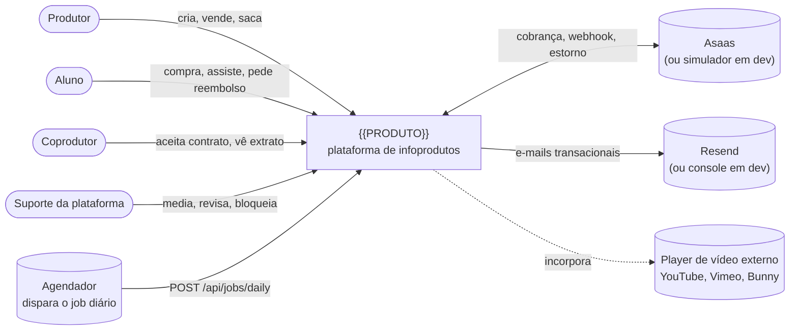

#### Contêineres

As partes que rodam e como se ligam.

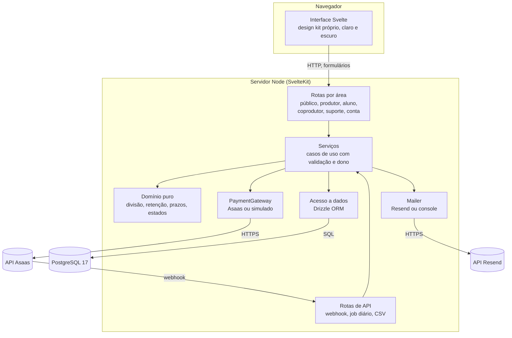

#### Camadas e regra de dependência

O código é dividido em camadas. Cada seta é uma dependência permitida; a regra é verificada no lint, então uma importação proibida quebra o build.

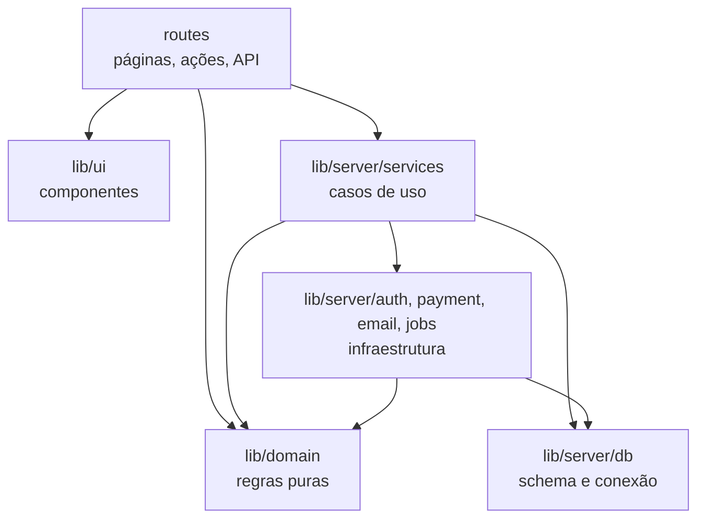

O domínio (`lib/domain`) não depende de nada fora dele: não conhece banco, framework nem provedor. Por isso as regras de dinheiro e prazo são testadas com funções puras, sem subir banco.

#### Implantação

Como o sistema roda em cada ambiente.

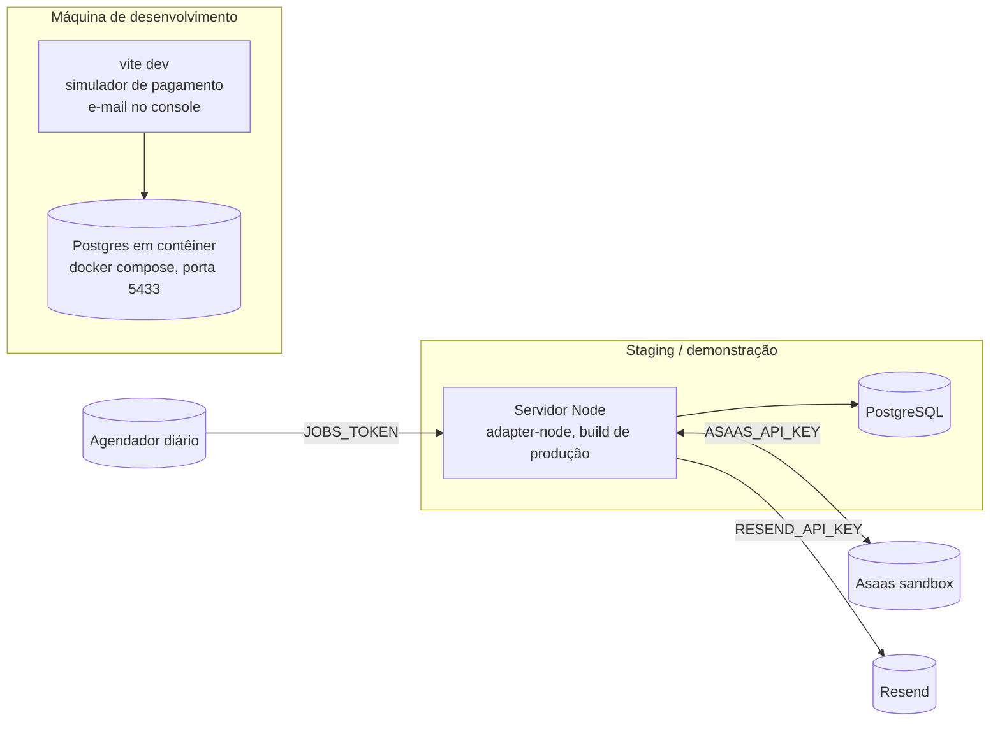

Os provedores reais ligam por variáveis de ambiente opcionais. Sem elas, o sistema usa o simulador e o log, o que permite rodar a demonstração sem internet.

## 2.5 Modelagem do sistema

### 2.5.1 Diagramas de casos de uso

#### Visão geral

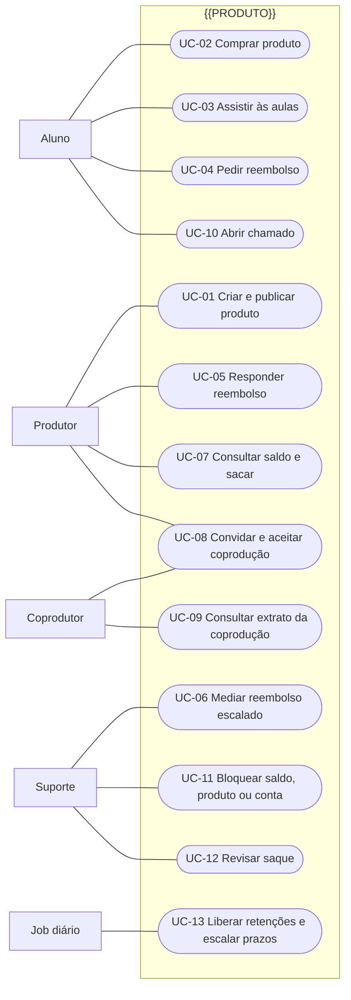

#### Reembolso em detalhe (inclusão e extensão)

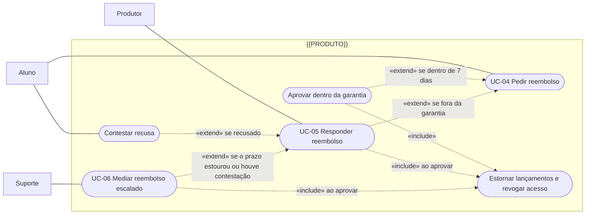

#### Descrição dos casos de uso

UC-01 a UC-09 são os casos de uso principais de `../produto/requisitos.md`. UC-10 a UC-13 completam o diagrama com o chamado, as ações do suporte e o job diário, que também existem no sistema.

| ID | Caso de uso | Ator | Pré-condição | Fluxo principal | Requisitos |
| --- | --- | --- | --- | --- | --- |
| UC-01 | Criar e publicar produto | Produtor | Conta criada | Responde o assistente, escolhe o modelo, edita páginas, cadastra aulas e oferta, resolve as pendências e publica | RF-10 a RF-16 |
| UC-02 | Comprar produto | Aluno | Produto publicado | Abre a página de venda, preenche o checkout, paga por Pix ou cartão, recebe o e-mail de acesso | RF-20 a RF-22 |
| UC-03 | Assistir às aulas | Aluno | Matrícula ativa | Abre o curso, assiste, marca a aula como concluída e vê o progresso | RF-23 |
| UC-04 | Pedir reembolso | Aluno | Pedido pago | Informa o motivo; vê status, responsável e prazo | RF-30 a RF-32 |
| UC-05 | Responder reembolso | Produtor | Pedido fora da garantia | Aprova, ou recusa com justificativa, dentro de 3 dias | RF-33 |
| UC-06 | Mediar reembolso escalado | Suporte | Prazo do produtor vencido ou recusa contestada | Lê a conversa e decide em até 3 dias | RF-34, RF-60 |
| UC-07 | Consultar saldo e sacar | Produtor | Saldo liberado ≥ R$ 50 | Vê retido, liberado e sacado; pede saque e vê a taxa antes de confirmar | RF-40 a RF-44 |
| UC-08 | Convidar e aceitar coprodução | Produtor, Coprodutor | Produto do produtor | Produtor convida com percentual e duração; coprodutor lê e aceita o contrato | RF-50 a RF-52 |
| UC-09 | Consultar extrato da coprodução | Coprodutor | Contrato aceito | Vê a própria parte de cada venda, com a regra aplicada | RF-53 |
| UC-10 | Abrir chamado | Aluno | Pedido do próprio aluno | Abre o chamado e conversa com o suporte | RF-35 |
| UC-11 | Bloquear saldo, produto ou conta | Suporte | Motivo e próximo passo definidos | Aplica o bloqueio; o produtor vê o motivo e o caminho | RF-45, RF-61, RF-62 |
| UC-12 | Revisar saque | Suporte | Saque solicitado | Conclui ou recusa; na recusa, o valor volta ao liberado | RF-44, RF-60 |
| UC-13 | Liberar retenções e escalar prazos | Job diário | Agendado uma vez por dia | Libera valores com garantia vencida, escala reembolsos vencidos, retenta estornos e expira pedidos | RN-04, RN-08 |

#### Histórias de usuário

**US-01 (UC-01).** Como produtor iniciante, quero responder poucas perguntas e receber um produto montado, para publicar sem pagar freelancer.
- Dado que respondi o assistente e escolhi um modelo, quando confirmo, então existem página de venda, checkout, área de membros, e-mails e política de reembolso em rascunho.
- A logo e a cor que informei aparecem em todas as páginas.
- O botão Publicar só habilita sem pendências, e as pendências são listadas.

**US-02 (UC-04).** Como aluno, quero pedir reembolso e saber quem está cuidando, para não ficar sem resposta.
- Ao pedir, vejo o status, o responsável (produtor ou plataforma) e a data limite.
- Dentro de 7 dias da compra o reembolso é aprovado sozinho e o status muda na hora.
- Se o produtor não responde no prazo, o responsável muda para a plataforma e eu vejo a mudança.

**US-03 (UC-07).** Como produtor, quero ver por que um valor está retido, para saber quando vou receber.
- Cada valor retido mostra o motivo (por exemplo, período de garantia) e a data exata de liberação.
- A soma de retido, liberado e sacado bate com a soma dos lançamentos.

**US-04 (UC-08 e UC-09).** Como coprodutor, quero ver quanto recebo de cada venda, para conferir a divisão.
- O extrato mostra valor bruto, taxa da plataforma, parte do produtor e a minha parte, com o percentual do contrato aplicado.
- Venda anterior ao aceite não gera lançamento para mim.

### 2.5.2 Diagramas de classe

#### Modelo de domínio

As entidades principais, seus atributos e associações. Os atributos seguem os nomes reais do código, em inglês.

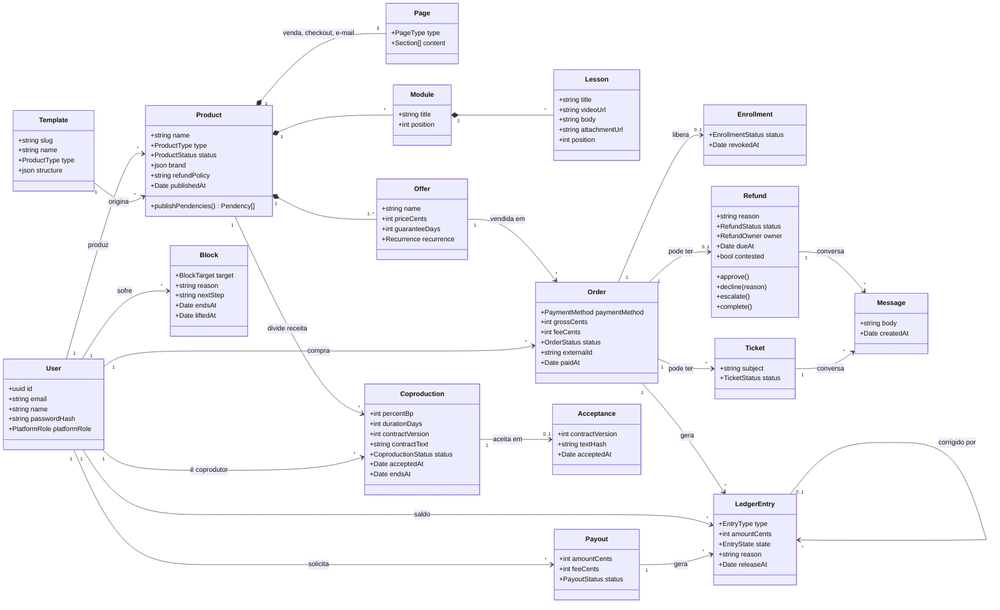

#### Portas e adaptadores

Os serviços falam com o pagamento e o e-mail por interfaces. Cada interface tem um adaptador real e um de desenvolvimento, escolhidos por variável de ambiente em `app.ts`.

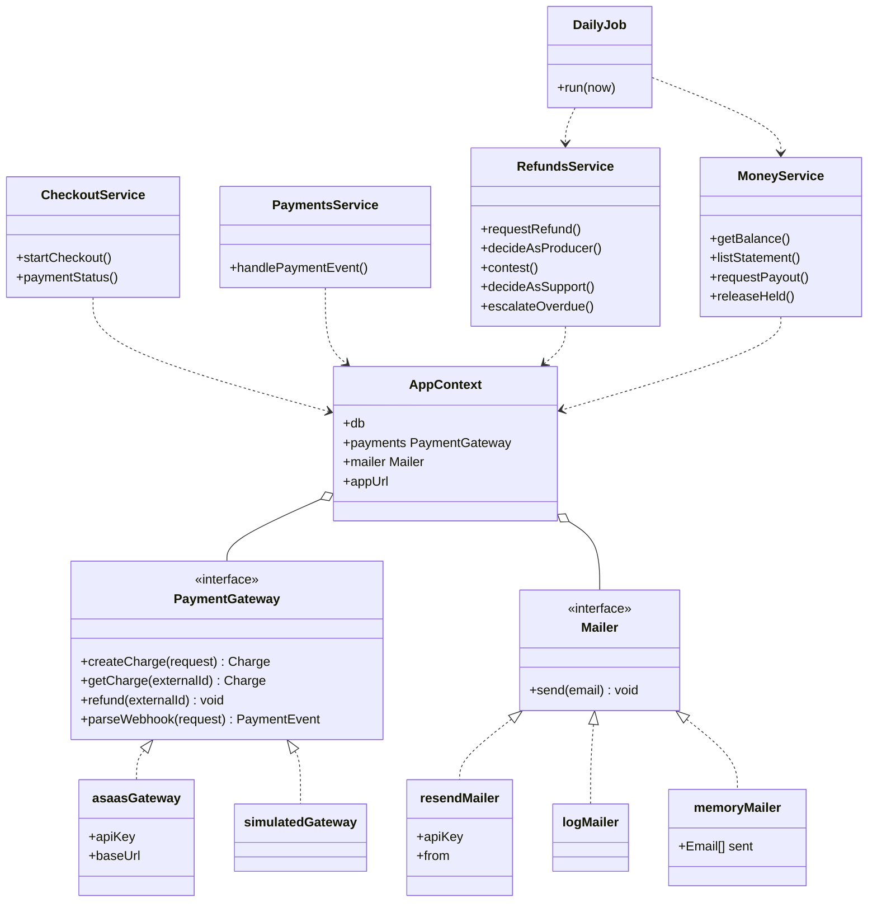

### 2.5.3 Diagrama entidade-relacionamento

Banco PostgreSQL. Valores em centavos inteiros e datas em UTC. Fonte: `src/lib/server/db/schema.ts` e as migrações em `drizzle/`.

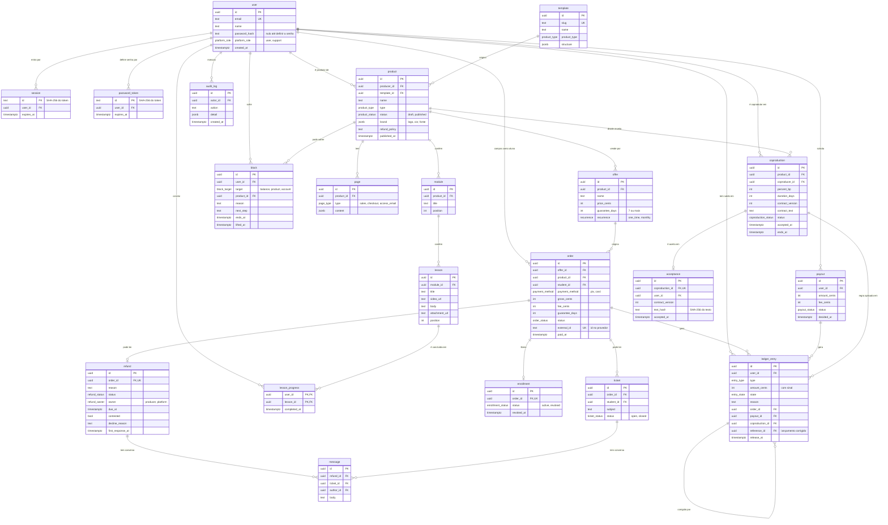

Decisões do modelo que valem destaque:

- **Papel não é tipo de conta.** Produtor, aluno e coprodutor são relações com um produto; só `platform_role` marca o suporte (RF-04).
- **O pedido guarda a foto da venda.** Preço, taxa e garantia são copiados da oferta no checkout, então mudar a oferta depois não reescreve vendas antigas.
- **O saldo nunca é uma coluna.** É sempre a soma dos lançamentos por estado, então o painel bate com o extrato por construção.
- **Lançamento não muda.** Um gatilho no banco só deixa mudar o estado, nas transições permitidas, e nunca apagar. Correção é um novo lançamento que aponta para o original.
- **Coprodução por versão.** Mudar o percentual cria uma nova versão; no aceite, a anterior termina no mesmo instante, então duas versões nunca valem juntas.
- **Regras no banco, não só no código.** Mais de 20 restrições (`UNIQUE`, `CHECK`, chaves compostas e gatilhos) garantem, por exemplo, que um pedido só é pago uma vez por cobrança, que todo reembolso tem responsável e prazo e que todo bloqueio tem motivo e próximo passo. A lista completa está em `../tecnico/modelo-de-dados.md`, seção 3.

### 2.5.4 Diagramas de sequência

#### Compra e liberação do acesso (UC-02)

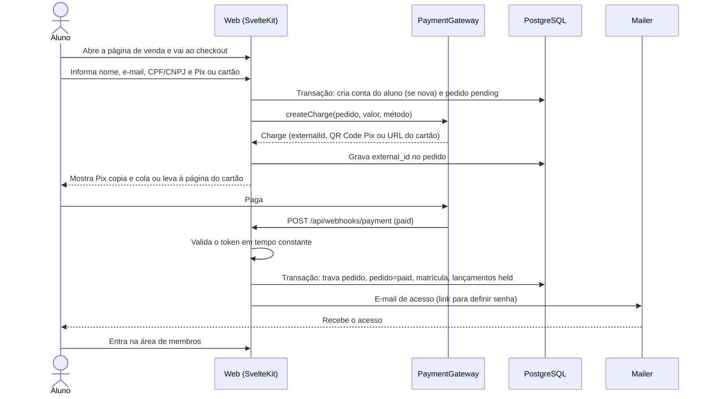

Se o provedor reenviar o mesmo webhook, o pedido já travado e pago é reconhecido pelo `external_id` e nada é duplicado (RN-15).

#### Reembolso fora da garantia com escalonamento (UC-04, UC-05, UC-06)

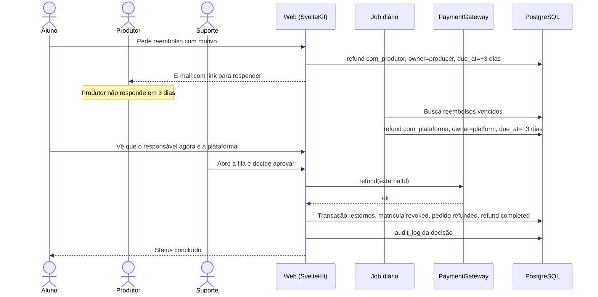

#### Convite e aceite de coprodução (UC-08)

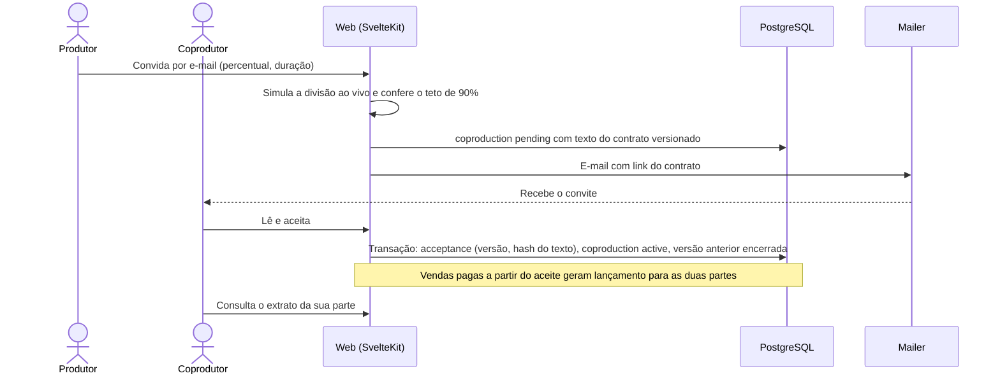

### 2.5.5 Diagramas de estados

#### Pedido

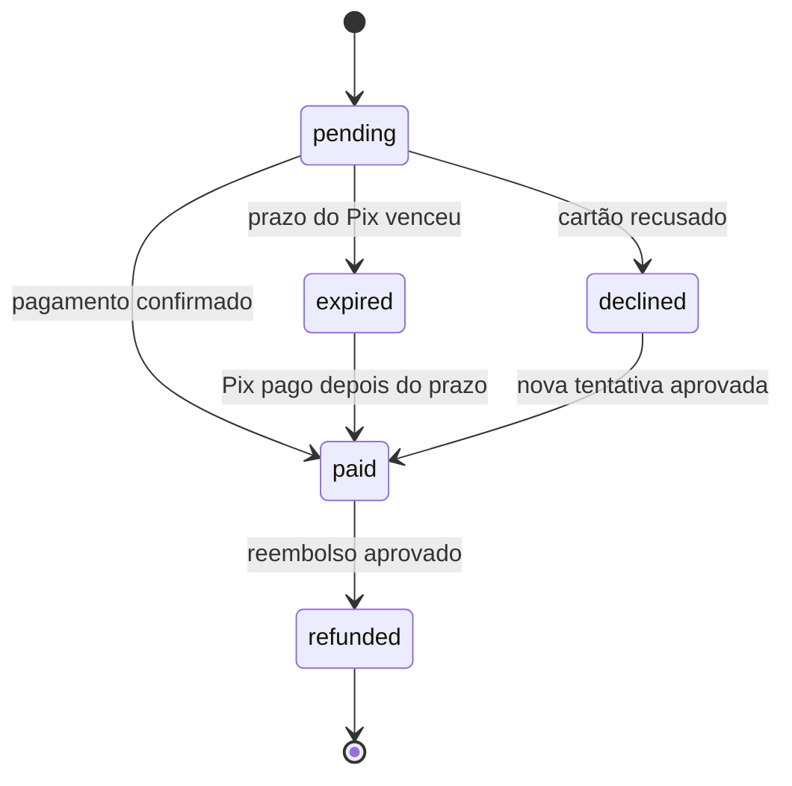

Um pedido expirado ou recusado ainda pode virar pago: se o dinheiro chegou, o aluno recebe o acesso.

#### Pedido de reembolso

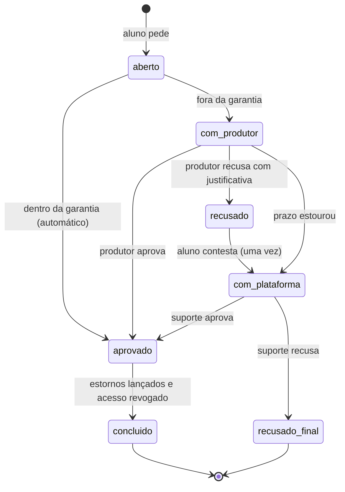

O estado define o responsável atual: `com_produtor` é o produtor e `com_plataforma` é o suporte. Nenhum pedido fica sem responsável e sem prazo (RN-10).

#### Valor no extrato

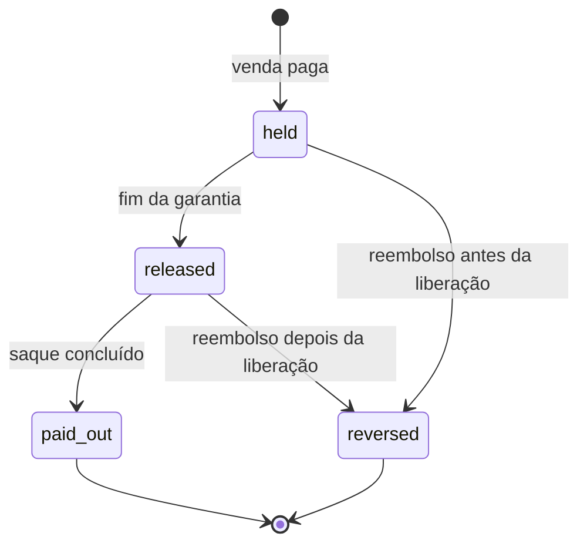

### 2.5.6 Diagrama de atividade: criação guiada (UC-01)

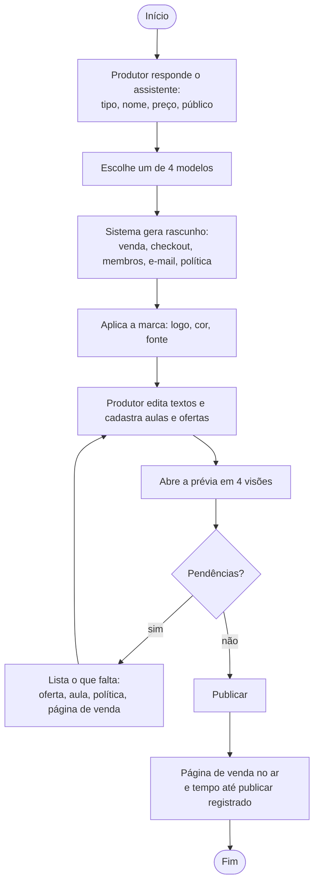

### 2.5.7 Diagrama de atividade: job diário (UC-13)

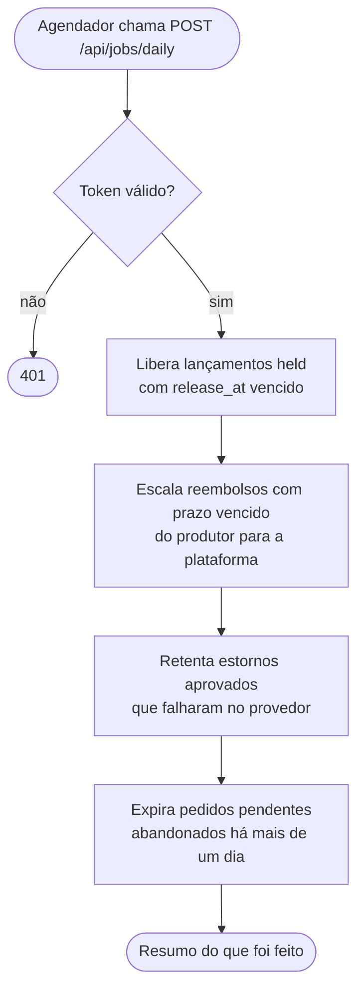

### 2.5.8 Mapa de navegação

As telas do MVP agrupadas por perfil. As capturas estão no Apêndice A.

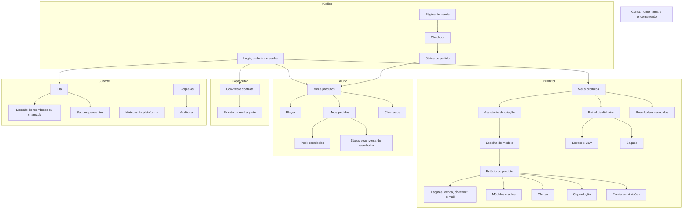
