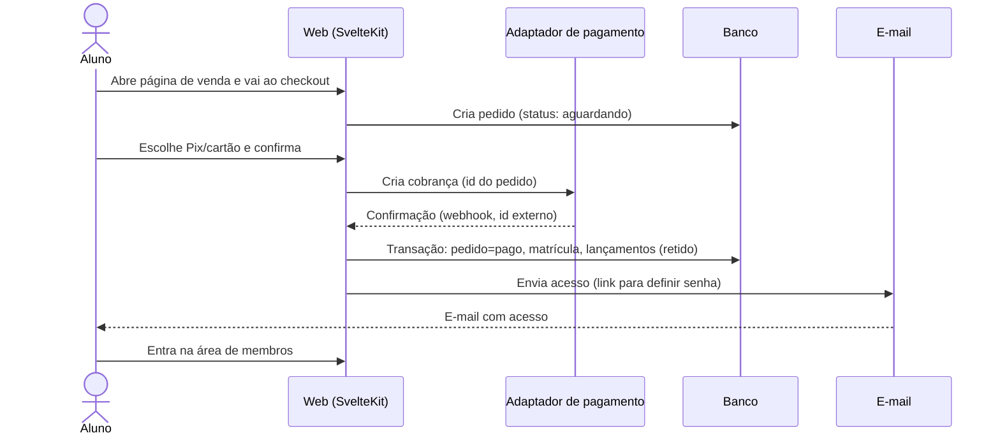
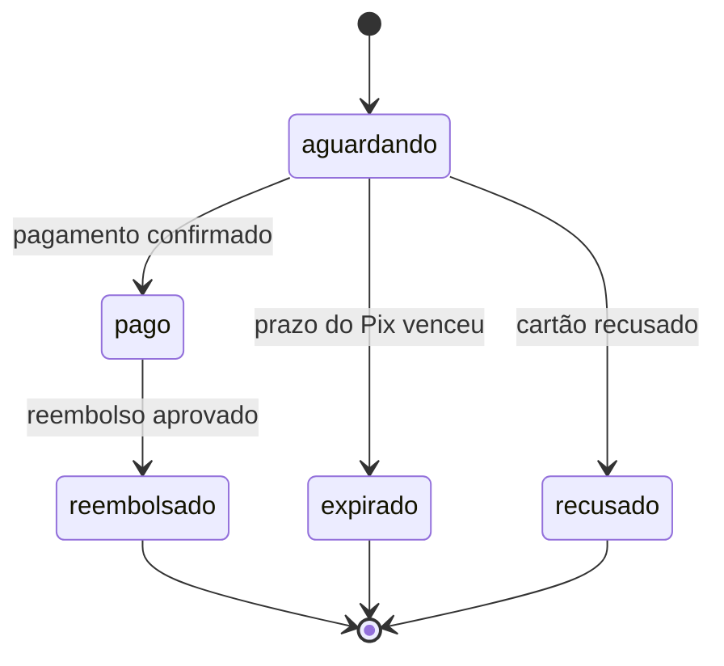
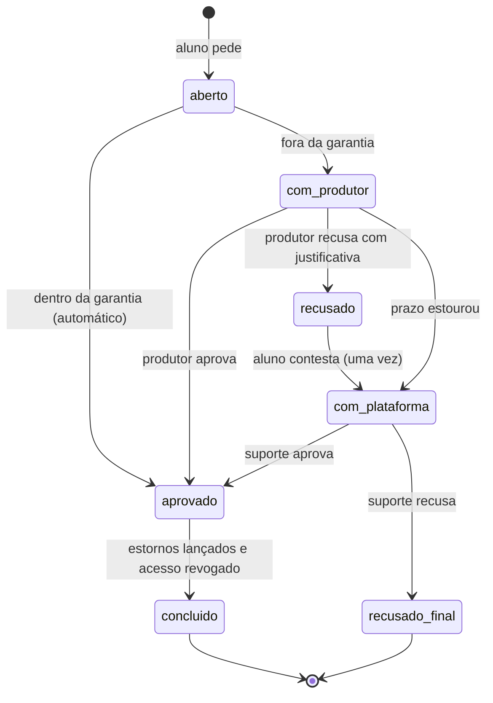
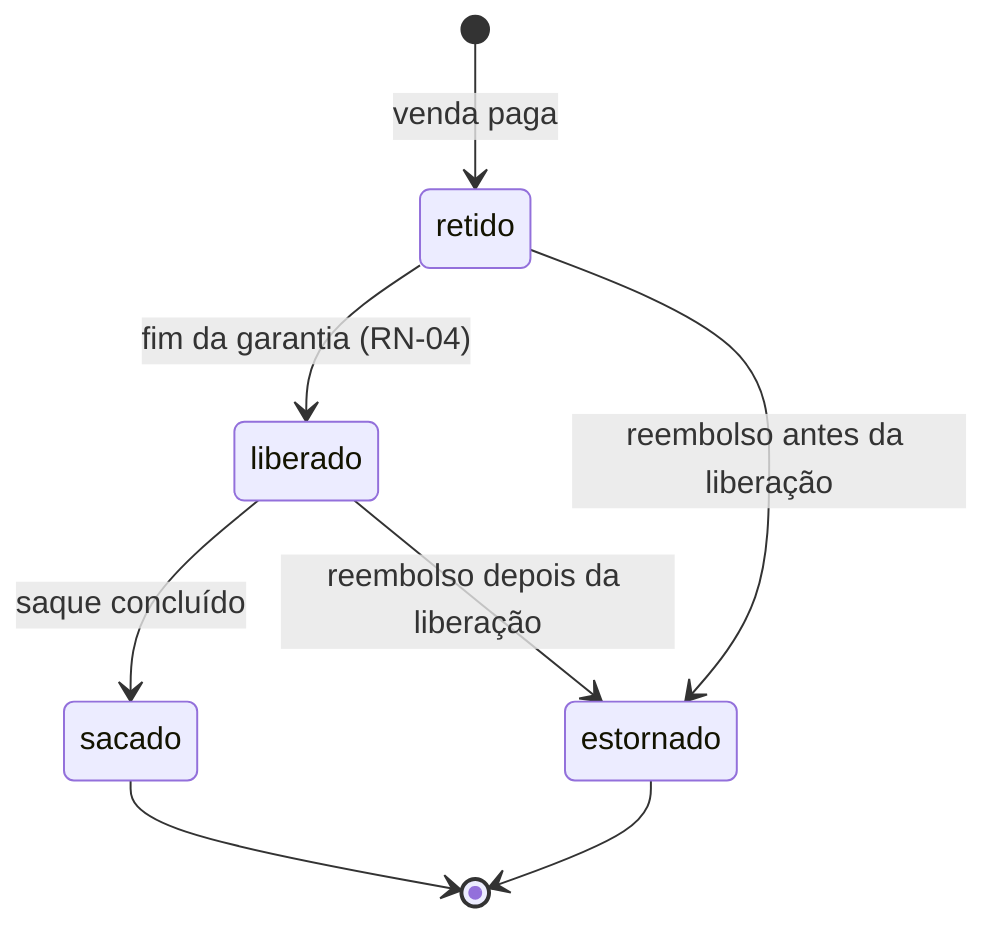
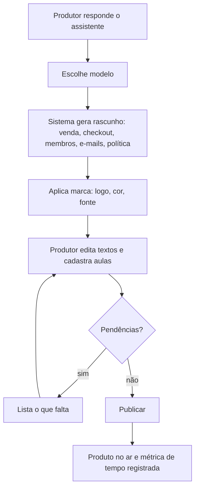
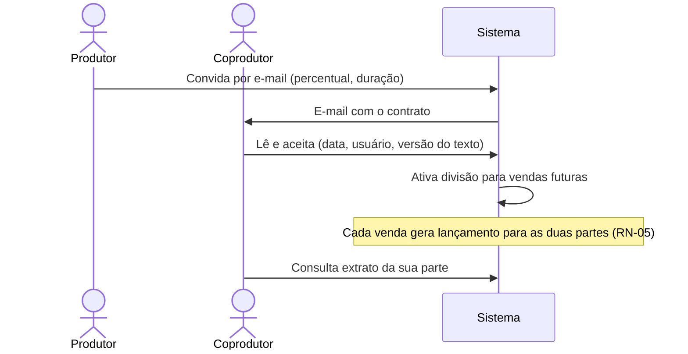

# Regras de negócio e fluxos

Valores marcados como **(hipótese)** são parâmetros configuráveis e devem ser confirmados pelo grupo.

## 1. Regras

| ID | Regra |
| --- | --- |
| RN-01 | Produto só pode ser publicado sem pendências: ao menos uma oferta, uma aula, política de reembolso e página de venda preenchida. |
| RN-02 | Taxa da plataforma: 5% do valor bruto + R$ 2,49 por venda **(hipótese)**. Mostrada ao produtor antes de publicar. Referência de mercado no Lean Canvas: Cakto 4,99% + R$ 2,49, Kiwify 8,99% + R$ 2,49. |
| RN-03 | Garantia de 7 dias corridos a partir da confirmação do pagamento, em todo produto. Reflete o direito de arrependimento do CDC para compra online. Pedido dentro da garantia é aprovado automaticamente. |
| RN-04 | Retenção: todo valor pago fica **retido até o fim da garantia**. Depois disso passa a **liberado**. O motivo e a data aparecem no painel. |
| RN-05 | Divisão da venda, nesta ordem: valor bruto, menos taxa da plataforma, igual ao líquido. Do líquido, o coprodutor recebe seu percentual (arredondado para baixo, em centavos) e o produtor recebe o restante. A soma das partes é sempre igual ao líquido. |
| RN-06 | Reembolso aprovado devolve o valor bruto ao aluno, revoga a matrícula e cria lançamentos de estorno para produtor e coprodutor, na mesma proporção da venda. A taxa fixa da plataforma não é devolvida **(hipótese)**: a plataforma devolve a parte percentual da taxa, e produtor e coprodutor devolvem o líquido mais a taxa fixa, divididos pela regra da RN-05. |
| RN-07 | Se o valor a estornar já foi liberado ou sacado e o saldo não cobre, o saldo do produtor fica negativo. Saque fica bloqueado enquanto o saldo for negativo, e o painel explica isso. |
| RN-08 | Pedido de fora da garantia: o produtor tem 3 dias corridos para aprovar ou recusar **(hipótese)**. Sem resposta, o pedido escala para o suporte, que tem mais 3 dias. Recusa exige justificativa visível ao aluno. |
| RN-09 | Aluno pode contestar uma recusa uma única vez. A contestação vai direto ao suporte. |
| RN-10 | Todo pedido de reembolso tem sempre um responsável atual (produtor ou plataforma) e um prazo. Nunca fica sem os dois. |
| RN-11 | Bloqueio de saldo ou produto pelo suporte exige motivo e um passo seguinte (ex.: enviar documento). Sem isso o sistema não grava o bloqueio. |
| RN-12 | Coprodução só tem efeito após o aceite do coprodutor. Alteração de percentual exige novo aceite e vale só para vendas posteriores. O percentual somado dos coprodutores de um produto não passa de 90% do líquido **(hipótese)**. |
| RN-13 | Saque: valor mínimo R$ 50 e taxa fixa de R$ 3,50, ambos mostrados antes da confirmação **(hipótese)**. A taxa sai do valor sacado. Só sobre saldo liberado. |
| RN-14 | Lançamentos são imutáveis. Correção é um novo lançamento que referencia o original. |
| RN-15 | Pagamento confirmado duas vezes (webhook repetido) gera um único pedido pago, identificado pelo id externo do provedor. |
| RN-16 | O acesso do aluno vale enquanto o pedido estiver pago e não reembolsado. Em assinatura, enquanto a recorrência estiver em dia. |

## 2. Fluxo: compra e liberação do acesso

## 3. Estados do pedido

## 4. Estados do pedido de reembolso

O estado `com_produtor` ou `com_plataforma` define o **responsável atual** (RN-10).

## 5. Estados de um valor no extrato

Uma tarefa agendada (job diário) move de `retido` para `liberado` o que já passou da data de liberação. Como cada lançamento muda o saldo no banco (estorno, saque, taxa) está em `../tecnico/modelo-de-dados.md`, seção 4.

## 6. Fluxo: criação guiada

## 7. Fluxo: coprodução

## 8. Métricas e eventos a registrar

| Métrica do Lean Canvas | Eventos necessários |
| --- | --- |
| Tempo até publicar o primeiro produto | `conta_criada`, `produto_publicado` (com timestamps) |
| Percentual de produtos publicados | `produto_criado`, `produto_publicado` |
| Tempo até resposta a reembolso | `reembolso_aberto`, `reembolso_primeira_resposta` |
| Contatos de suporte por produtor | `chamado_aberto` com produtor dono do produto |
