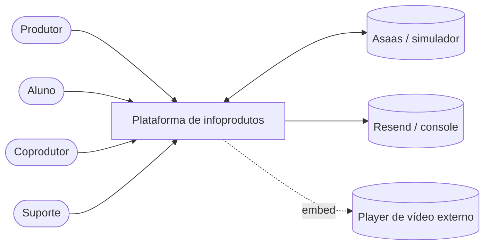
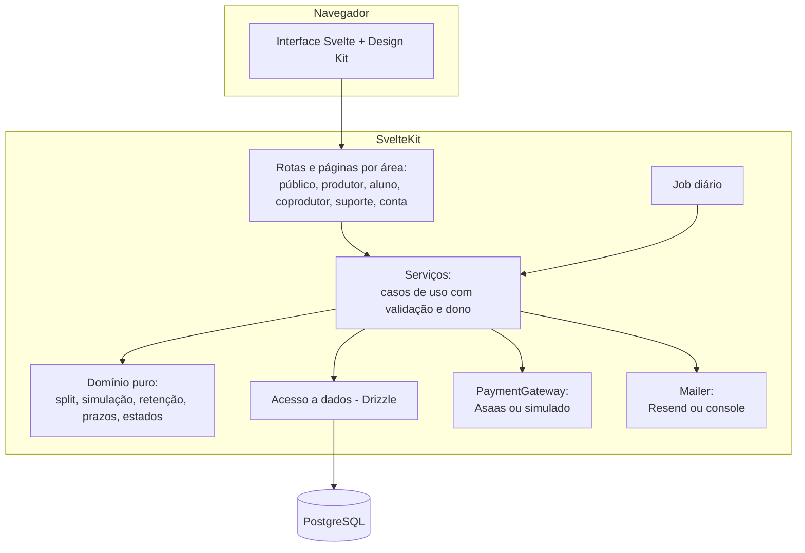

# Arquitetura

Arquitetura do MVP implementada e validada (decisão D2 confirmada). O princípio é o menor número de peças que resolve o produto ponta a ponta com segurança financeira e isolamento por perfil.

## 1. Decisões

| Tema | Escolha | Motivo |
| --- | --- | --- |
| Aplicação | Monólito SvelteKit (páginas, ações de formulário e rotas de API no mesmo projeto) | Um só deploy, um só repositório; exigência da matéria |
| Linguagem | TypeScript com `strict` e `noUncheckedIndexedAccess` | RNF-09 |
| Banco | PostgreSQL | Transações e restrições fortes para dinheiro |
| Acesso a dados | Drizzle ORM com migrações versionadas (`0000` a `0005`) | Tipos de ponta a ponta, SQL previsível |
| Validação | Zod nas fronteiras (formulários, query strings, webhooks) | Nunca confiar na entrada |
| Autenticação e conta | Sessão em cookie HttpOnly, senha com argon2, redirecionamento seguro `?next=` e encerramento/anonimização LGPD (`closeAccount`) | RNF-04, RNF-06 |
| Pagamento | Interface `PaymentGateway` com `asaasGateway` (API v3 do Asaas via `ASAAS_API_KEY`) e `simulatedGateway` em dev | Troca por variável de ambiente sem tocar no domínio (ver `pagamentos.md`) |
| Vídeo | URL de player externo (YouTube, Vimeo, arquivo direto ou link externo) guardada na aula | Hospedar vídeo custa caro e não é o diferencial |
| E-mail | Interface `Mailer` com `resendMailer` (`RESEND_API_KEY` + `EMAIL_FROM`) e `logMailer` em dev | RF-22, decisão D2 |
| Modelos e cobrança | 4 modelos semeados (`online-course`, `mentorship`, `subscription-club`, `workshop`) com pagamento único ou assinatura mensal | RF-10, RF-11, decisão D5 |
| Jobs | Tarefa agendada diária (liberar retenções, escalar reembolsos vencidos, retentar estornos, expirar pedidos) | Evita fila e workers no MVP |
| Testes | Vitest (unitários, propriedades e integração com Postgres) e Playwright (fluxos, axe e acesso) | RNF-10 |

## 2. Contexto do sistema



## 3. Contêineres



## 4. Organização do código

Todo código, pasta e arquivo é em inglês (ver `convencoes.md`).

```
src/
  env.ts          # validação das variáveis de ambiente obrigatórias e opcionais
  hooks.server.ts # sessão em locals e injeção SSR do tema (cookie cakto_theme)
  lib/
    domain/       # funções puras e testadas; não importam banco nem framework
      params.ts  money.ts  split.ts  simulation.ts  retention.ts  payout.ts
      refund.ts  coproduction.ts  states.ts  publish.ts  page.ts  draft.ts  tax-id.ts
    server/
      app.ts      # contexto da aplicação (banco, Asaas/simulado, Resend/log, APP_URL)
      http.ts     # act, orNotFound, requireUser, requireSupport: erros viram respostas
      services/   # casos de uso; as rotas só chamam estes
      db/         # schema Drizzle e conexão
      auth/       # contas (cadastro, login, nome, encerramento LGPD), sessão, links de senha
      payment/    # PaymentGateway + asaas.ts + simulated.ts
      email/      # Mailer + resend.ts + logMailer/memoryMailer
      jobs/       # job diário
    ui/           # kit próprio de componentes acessíveis (claro/escuro, mobile-first)
  routes/
    (public)/     # página de venda, checkout, status do pedido, login, cadastro, senha
    (app)/        # Shell autenticado com marca e contadores de pendências
      producer/   # produtos, assistente, estúdio (páginas, aulas, ofertas, coprodução, prévia), dinheiro, reembolsos
      student/    # cursos/player, pedidos, reembolsos, chamados
      coproductions/ # convites e contrato versionado
      support/    # fila, métricas Lean Canvas, saques, bloqueios, auditoria
      account/    # nome, aparência (tema) e encerramento LGPD
    api/          # webhook de pagamento, job diário, exportação CSV do extrato, simulador (dev)
drizzle/          # migrações 0000 a 0005 (0003 e 0005 semeiam os 4 modelos de produto)
```

Regra de dependência: `routes` usa `server`, `domain` e `ui`; `domain` não depende de nada fora dele; páginas em `routes` usam componentes de `#lib/ui` em vez de controles HTML crus. Verificada no CI (`pnpm lint`).

## 4.1 Serviços e autenticação

Cada função de `src/lib/server/services` é um caso de uso. Recebe o contexto (`ctx`), o id de quem pede e a entrada crua; valida a entrada com Zod, filtra pelo dono na própria consulta e grava em transação. Recurso de outra pessoa responde como inexistente (`NotFoundError`, RNF-05). O horário entra como parâmetro `now`, para os testes controlarem prazos.

| Arquivo | O que cobre |
| --- | --- |
| `catalog.ts` | 4 modelos, criação guiada, estúdio (`sales`, `checkout`, `access_email`, módulos, aulas, ofertas únicas e mensais), contagens de aulas/vendas, publicação, página de venda e checkout públicos |
| `checkout.ts` | início da compra (pagamento único ou mensal) e status do pagamento |
| `payments.ts` | eventos do provedor: pagamento, expiração, recusa, reembolso externo |
| `refunds.ts` | pedido (com e-mail ao produtor fora da garantia), decisão do produtor, contestação, decisão do suporte, conversa, escalonamento |
| `money.ts` | saldo, painel de dinheiro com receita líquida de 7 dias, extrato paginado com total, saque, liberação de retenções |
| `coproduction.ts` | convite, aceite com contrato versionado, cancelamento, listas |
| `members.ts` | área do aluno: produtos com tipo e progresso, curso, progresso, pedidos |
| `support.ts` | fila (reembolsos, chamados e saques pendentes), métricas (`getPlatformMetrics`), bloqueios, auditoria, chamados com nome do produto |
| `profiles.ts` | perfis ativos da conta, perfil inicial (`homeProfile`) e contadores de pendências (`listPendingCounts`) |
| `auth/accounts.ts` | cadastro, autenticação, redirecionamento seguro (`safeNext`), edição de nome (`updateUserName`) e encerramento/anonimização LGPD (`closeAccount`) |

Erros de regra saem como `DomainError` com um `code` estável (lista em `src/lib/domain/states.ts`); a interface traduz o código para português em `src/lib/error-text.ts`. Nas ações de formulário, `act()` converte `DomainError` e erro de validação em `fail(400, { code })` e `NotFoundError` em 404.

## 4.2 Rotas apontadas por e-mails

Todos os links enviados por e-mail são conferidos contra as rotas reais e a origem `APP_URL` em `src/lib/server/email-links.int.test.ts`:

| Rota | Uso |
| --- | --- |
| `/password/[token]` | definir a primeira senha (pós-compra ou convite) ou recuperar (`setPasswordWithToken`) |
| `/student` | área do aluno, link do e-mail de acesso quando a pessoa já tem senha |
| `/coproductions/[id]` | ler e aceitar ou recusar o contrato de coprodução |
| `/producer/refunds/[id]` | responder a um pedido de reembolso aberto fora do prazo de garantia |
| `/dev/payments/[externalId]` | página de pagamento simulada (só em desenvolvimento) |

## 5. Segurança, privacidade e integridade

- Toda rota do servidor checa o papel e o dono do recurso antes de ler ou gravar (RNF-05), coberta por varredura automatizada em `e2e/review-access.spec.ts`.
- Encerramento de conta LGPD (`closeAccount`, RNF-06): exige confirmação de senha, trava o usuário (`FOR UPDATE`), recusa encerramento se houver saldo retido/liberado diferente de zero, saque pendente, reembolso em aberto ou bloqueio ativo (`account_has_open_obligations`), despublica produtos, cancela convites pendentes e apaga a conta sem histórico ou anonimiza nome e e-mail quando há histórico contábil/operacional.
- Exportação CSV (`GET /api/statement/export`): exige sessão, filtra apenas lançamentos do próprio usuário e neutraliza gatilhos de fórmula (`=`, `+`, `-`, `@`, `\t`, `\r`) antes de citar em RFC 4180 com UTF-8 BOM.
- Webhook valida o token do provedor em tempo constante e trava o pedido pelo `external_id` para ser idempotente (RN-15).
- Pagamento confirmado, matrícula e lançamentos são gravados em **uma transação**.
- Ações do suporte gravam em `audit_log` (RF-62).
- Segredos só em variáveis de ambiente; nunca no repositório.

## 6. Ambientes

| Ambiente | Uso |
| --- | --- |
| Local | Desenvolvimento com Postgres em contêiner, simulador de pagamento e log de e-mail |
| Staging / Demo | Apresentação e homologação, podendo ligar Asaas sandbox (`ASAAS_API_KEY`) e Resend (`RESEND_API_KEY`) |
| Produção | Fora do escopo operacional acadêmico, mas adaptadores HTTP prontos |

## 7. Riscos técnicos e mitigações aplicadas

| Risco | Mitigação aplicada |
| --- | --- |
| Editor de páginas grande demais para o prazo | Seções estruturadas dos 4 modelos nas 3 páginas (`sales`, `checkout`, `access_email`), editando texto, imagem e ordem |
| Divisão e estorno com arredondamento errado | Funções puras em centavos e basis points com testes de propriedade (soma das partes igual ao líquido) |
| Escopo crescer com recursos de concorrentes | Escopo travado em `../produto/visao-e-escopo.md` |
