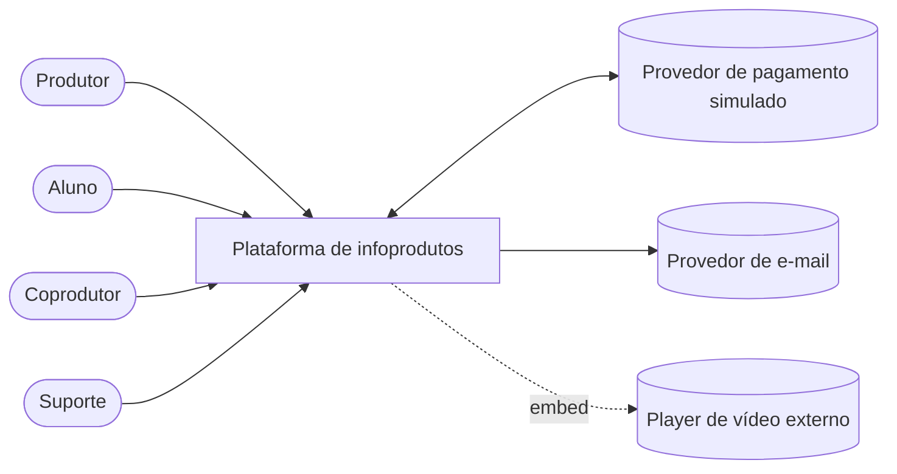

# Arquitetura

As escolhas de tecnologia abaixo são **propostas** a confirmar pelo grupo. O princípio é o menor número de peças que resolve o MVP.

## 1. Decisões

| Tema | Proposta | Motivo |
| --- | --- | --- |
| Aplicação | Monólito SvelteKit (páginas, ações de formulário e rotas de API no mesmo projeto) | Um só deploy, um só repositório; exigência da matéria |
| Linguagem | TypeScript com `strict` | RNF-09 |
| Banco | PostgreSQL | Transações e restrições fortes para dinheiro |
| Acesso a dados | Drizzle ORM com migrações versionadas | Tipos de ponta a ponta, SQL previsível |
| Validação | Zod nas fronteiras (formulários, webhooks) | Nunca confiar na entrada |
| Autenticação | Sessão em cookie HttpOnly, senha com argon2 | RNF-04 |
| Pagamento | Interface `PaymentGateway` com implementação simulada, no formato do Asaas | Pagamento próprio está fora do escopo; troca futura sem mexer no domínio (ver `pagamentos.md`) |
| Vídeo | URL de player externo guardada na aula | Hospedar vídeo custa caro e não é o diferencial |
| E-mail | Provedor transacional (ex.: Resend) com modelos do produtor | RF-22 |
| Jobs | Tarefa agendada diária (liberar retenções, escalar reembolsos vencidos) | Evita fila e workers no MVP |
| Testes | Vitest para regras puras; Playwright para fluxos críticos | RNF-10 |

## 2. Contexto do sistema



## 3. Contêineres

```mermaid
flowchart TB
    subgraph Navegador
        UI[Interface Svelte]
    end

    subgraph SvelteKit
        Rotas[Rotas e páginas por área:<br/>produtor, aluno, suporte, público]
        Servicos[Serviços:<br/>casos de uso com validação e dono]
        Dominio[Domínio puro:<br/>split, retenção, prazos, estados]
        Dados[Acesso a dados - Drizzle]
        GW[PaymentGateway]
        Mail[Mailer]
        Cron[Job diário]
    end

    DB[(PostgreSQL)]

    UI --> Rotas
    Rotas --> Servicos
    Cron --> Servicos
    Servicos --> Dominio
    Servicos --> Dados
    Servicos --> GW
    Servicos --> Mail
    Dados --> DB
```



## 4. Organização do código

Todo código, pasta e arquivo é em inglês (ver `convencoes.md`).

```
src/
  lib/
    domain/       # funções puras e testadas; não importam banco nem framework
      params.ts  money.ts  split.ts  retention.ts  payout.ts  refund.ts
      coproduction.ts  states.ts  publish.ts  draft.ts  tax-id.ts
    server/
      app.ts      # o contexto da aplicação (banco, provedor, e-mail, URL)
      http.ts     # act, requireUser, requireSupport: erros viram respostas
      services/   # casos de uso; as rotas só chamam estes
      db/         # schema Drizzle e conexão
      auth/       # senha, sessão, cookie, links de senha
      payment/    # PaymentGateway + implementação simulada
      email/      # Mailer (hoje escreve no console)
      jobs/       # job diário
    ui/           # kit de componentes
  routes/
    (public)/     # página de venda, checkout, login
    producer/     # criação guiada, produtos, painel de dinheiro, coprodução
    student/      # área de membros, pedidos, reembolsos
    support/      # fila, bloqueios, auditoria
    api/          # webhook do provedor, job diário, simulador de pagamento (dev)
drizzle/          # migrações geradas (0003 semeia os modelos de produto)
```

Regra de dependência: `routes` usa `server` e `domain`; `domain` não depende de nada fora dele. Verificada no CI (`pnpm lint`).

## 4.1 Serviços

Cada função de `src/lib/server/services` é um caso de uso. Recebe o contexto (`ctx`), o id de quem pede e a entrada crua; valida a entrada com Zod, filtra pelo dono na própria consulta e grava em transação. Recurso de outra pessoa responde como inexistente (`NotFoundError`, RNF-05). O horário entra como parâmetro `now`, para os testes controlarem prazos.

| Arquivo | O que cobre |
| --- | --- |
| `catalog.ts` | modelos, criação guiada, editor (páginas, módulos, aulas, ofertas), publicação, página de venda e checkout públicos |
| `checkout.ts` | início da compra e status do pagamento |
| `payments.ts` | eventos do provedor: pagamento, expiração, recusa, reembolso externo |
| `refunds.ts` | pedido, decisão do produtor, contestação, decisão do suporte, conversa, escalonamento |
| `money.ts` | saldo, painel de dinheiro, extrato, saque, liberação de retenções |
| `coproduction.ts` | convite, aceite com contrato, cancelamento, listas |
| `members.ts` | área do aluno: produtos, curso, progresso, pedidos |
| `support.ts` | fila, bloqueios, auditoria, chamados |

Erros de regra saem como `DomainError` com um `code` estável (lista em `src/lib/domain/states.ts`); a interface traduz o código para português. Nas ações de formulário, `act()` converte `DomainError` e erro de validação em `fail(400, { code })` e `NotFoundError` em 404.

## 4.2 Rotas que o backend já espera

Os e-mails apontam para estas telas, que o frontend precisa criar:

| Rota | Uso |
| --- | --- |
| `/password/[token]` | definir a primeira senha ou recuperar (`setPasswordWithToken`) |
| `/student` | área do aluno, link do e-mail de acesso |
| `/coproductions/[id]` | ver e aceitar o contrato de coprodução |
| `/dev/payments/[externalId]` | página de pagamento simulada (só em desenvolvimento) |

## 5. Segurança e integridade

- Toda rota do servidor checa o papel e o dono do recurso antes de ler ou gravar (RNF-05).
- Webhook valida o token do provedor e trava o pedido pelo `external_id` para ser idempotente (RN-15).
- Pagamento confirmado, matrícula e lançamentos são gravados em **uma transação**.
- Ações do suporte gravam em `AUDITORIA` (RF-62).
- Segredos só em variáveis de ambiente; nunca no repositório.

## 6. Ambientes

| Ambiente | Uso |
| --- | --- |
| Local | Desenvolvimento com Postgres em contêiner |
| Staging | Demonstração e apresentação, dados fictícios |
| Produção | Fora do MVP acadêmico |

## 7. Riscos técnicos

| Risco | Mitigação |
| --- | --- |
| Editor de páginas grande demais para o prazo | Começar com seções fixas dos modelos e edição só de texto, imagem e ordem |
| Divisão e estorno com arredondamento errado | Funções puras com testes de propriedade (soma das partes igual ao líquido) |
| Escopo crescer com recursos de concorrentes | Lista de "fora do MVP" em `../produto/visao-e-escopo.md` |
