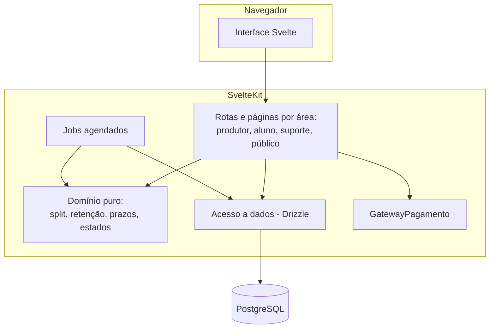

# Arquitetura

As escolhas de tecnologia abaixo são **propostas** a confirmar pelo grupo. O princípio é o menor número de peças que resolve o MVP.

## 1. Decisões

| Tema | Proposta | Motivo |
| --- | --- | --- |
| Aplicação | Monólito SvelteKit (páginas, ações de formulário e rotas de API no mesmo projeto) | Um só deploy, um só repositório; exigência da matéria |
| Linguagem | TypeScript com `strict` | RNF-09 |
| Banco | PostgreSQL | Transações e restrições fortes para dinheiro |
| Acesso a dados | Drizzle ORM com migrações versionadas | Tipos de ponta a ponta, SQL previsível |
| Validação | Zod nas fronteiras (formulários, webhooks) | Nunca confiar na entrada |
| Autenticação | Sessão em cookie HttpOnly, senha com argon2 | RNF-04 |
| Pagamento | Interface `PaymentGateway` com implementação simulada | Pagamento próprio está fora do escopo; troca futura sem mexer no domínio |
| Vídeo | URL de player externo guardada na aula | Hospedar vídeo custa caro e não é o diferencial |
| E-mail | Provedor transacional (ex.: Resend) com modelos do produtor | RF-22 |
| Jobs | Tarefa agendada diária (liberar retenções, escalar reembolsos vencidos) | Evita fila e workers no MVP |
| Testes | Vitest para regras puras; Playwright para fluxos críticos | RNF-10 |

## 2. Contexto do sistema


## 3. Contêineres



## 4. Organização do código

Todo código, pasta e arquivo é em inglês (ver `convencoes.md`).

```
src/
  lib/
    domain/       # funções puras e testadas; não importam banco nem framework
      params.ts  money.ts  split.ts  retention.ts  payout.ts
      refund.ts  coproduction.ts  states.ts  publish.ts
    server/
      db/         # schema Drizzle, conexão, consultas
      auth/       # senha, sessão, cookie
      payment/    # PaymentGateway + implementação simulada
      email/
      jobs/
    components/   # UI compartilhada
  routes/
    (public)/     # página de venda, checkout, login
    producer/     # criação guiada, produtos, painel de dinheiro, coprodução
    student/      # área de membros, pedidos, reembolsos
    support/      # fila, bloqueios, auditoria
    api/webhooks/ # retorno do provedor de pagamento
drizzle/          # migrações geradas
```

Regra de dependência: `routes` pode usar `server` e `domain`; `domain` não depende de nada fora dele. Verificada no CI (`pnpm lint`).

## 5. Segurança e integridade

- Toda rota do servidor checa o papel e o dono do recurso antes de ler ou gravar (RNF-05).
- Webhook valida assinatura e usa `id_externo` para ser idempotente (RN-15).
- Pagamento confirmado, matrícula e lançamentos são gravados em **uma transação**.
- Ações do suporte gravam em `AUDITORIA` (RF-62).
- Segredos só em variáveis de ambiente; nunca no repositório.

## 6. Ambientes

| Ambiente | Uso |
| --- | --- |
| Local | Desenvolvimento com Postgres em contêiner |
| Staging | Demonstração e apresentação, dados fictícios |
| Produção | Fora do MVP acadêmico |

## 7. Riscos técnicos

| Risco | Mitigação |
| --- | --- |
| Editor de páginas grande demais para o prazo | Começar com seções fixas dos modelos e edição só de texto, imagem e ordem |
| Divisão e estorno com arredondamento errado | Funções puras com testes de propriedade (soma das partes igual ao líquido) |
| Escopo crescer com recursos de concorrentes | Lista de "fora do MVP" em `../produto/visao-e-escopo.md` |
