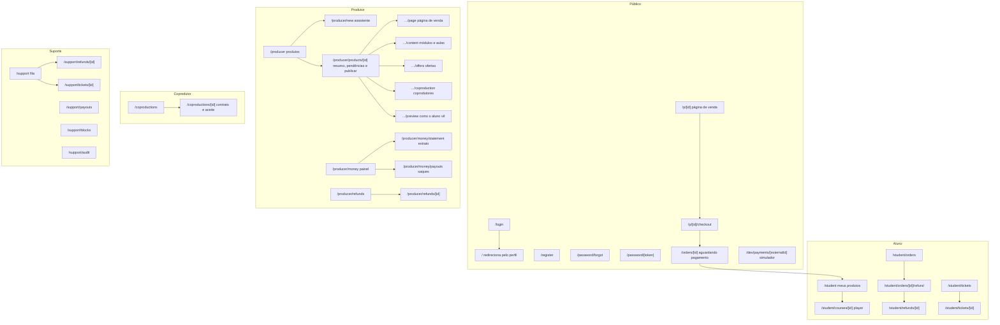

# Plano do frontend

Mapa de telas do MVP, dividido em lotes pequenos. Cada lote é um PR: fecha telas inteiras, ligadas aos serviços reais de `src/lib/server/services`, com testes. A porcentagem é o avanço acumulado do frontend ao fim do lote.

O backend já existe, então cada tela nasce ligada ao seu serviço (`load` e ações de formulário com `act()`). A fase final não liga telas: junta as jornadas completas entre perfis, fecha buracos de navegação e faz a revisão geral.

## 1. Definição de pronto de uma tela

Uma tela só conta como pronta quando cumpre tudo abaixo.

| Item | Critério |
| --- | --- |
| Kit | Só componentes de `#lib/ui`; peça nova segue `docs/design/README.md` seção 4 |
| Estados | Carregando (`Skeleton`), vazio (`EmptyState`), erro (`Alert` com o código traduzido), sucesso (`Toast` ou mudança visível) |
| Formulário | Funciona sem JavaScript; com JS usa `use:enhance`, mostra `loading` no botão e erro no campo certo |
| Responsivo | Revisada em 375 px e em desktop; checkout e área do aluno pensados primeiro para celular (RNF-08) |
| Tema | Revisada em claro e escuro |
| Acessibilidade | Navegável só por teclado, foco visível, rótulos, sem violação do axe |
| Acesso | Rota checa papel e dono no servidor (RNF-05); recurso de outra pessoa responde 404 |
| Testes | Lógica pura nova com Vitest; e2e Playwright do caminho feliz e de um caminho de erro; e2e de acesso negado quando a tela é de um perfil |
| Revisão | Captura das telas (mobile e desktop) na descrição do PR |

## 2. Mapa de rotas

Uma conta pode ter vários perfis (RF-04). O `Shell` mostra na barra lateral as seções de cada perfil que a pessoa tem: Produtor sempre, Aluno se tem matrícula ou pedido, Coprodução se tem convite, Suporte só para `support`.

## 3. Lotes

### Fase 0. Fundação (0 a 10%)

| Lote | Entrega | % |
| --- | --- | --- |
| 0.1 | Playwright instalado, banco de teste isolado, fixtures que criam usuário, produto publicado e compra pelos serviços (`services/testing.ts`), login por fixture, axe; job no CI | 4 |
| 0.2 | Tradução de `DomainErrorCode` para português num só lugar, com teste que falha se faltar código; padrão de formulário (`act()` + `use:enhance` + erro por campo) | 7 |
| 0.3 | Layout autenticado com `Shell` e navegação por perfil, `Toast` montado, páginas de erro 404 e 500, guarda de papel por grupo de rota (`producer`, `student`, `support`) | 10 |

Concluída em 10/11/2026. Como ficou: `convencoes.md` seção 6. Duas decisões no caminho: o botão de sair fica na página da conta (lote 1.2), porque o catálogo reserva `NavItem` para navegação; e o texto secundário claro do kit subiu de 60% para 76% de opacidade para passar no contraste AA do axe (`design/cores.md`). As telas de `/producer`, `/student`, `/coproductions` e `/support` são provisórias até os lotes 2.1, 4.1, 7.2 e 8.1.

### Fase 1. Conta e acesso (10 a 17%)

| Lote | Telas | Serviços | % |
| --- | --- | --- | --- |
| 1.1 | `/login`, `/register` migradas para o kit (sai a isenção do ESLint), `/` redireciona pelo perfil | `startSession`, `findOrCreateAccount` | 13 |
| 1.2 | `/password/forgot`, `/password/[token]` (primeira senha e recuperação), `/account` com sair | `requestPasswordReset`, `setPasswordWithToken` | 17 |

E2e: cadastrar, entrar, sair; senha errada; link expirado; usuário logado sem papel de suporte recebe 404 em `/support`.

Concluída em 10/11/2026. Cadastro e login saíram das rotas para `auth/accounts.ts` (`register`, `authenticate`), com o código novo `invalid_credentials`. Um e-mail que já tem conta sem senha (comprador ou convidado) conta como ocupado: a pessoa entra pelo link de senha, nunca se cadastrando de novo. `/` usa `homeProfile`: suporte vai para a fila; quem só comprou ou foi convidado, sem produto próprio, vai para essa área; o resto vai para Produtos. A página do link (`passwordTokenOwner`) já diz na abertura se o link expirou e se é a primeira senha. No caminho, o link e o texto de erro do kit passaram a ter contraste AA nos dois temas (`design/cores.md`).

### Fase 2. Criação do produto, UC-01 (17 a 42%)

| Lote | Telas | Serviços | % |
| --- | --- | --- | --- |
| 2.1 | `/producer`: lista com estado, preço e ação principal; vazio leva ao assistente | `listProducerProducts` | 20 |
| 2.2 | `/producer/new`: assistente com `Stepper`, uma pergunta por passo (tipo, nome, preço, público, marca com `ColorField`, fonte e URL da logo) | `createProductSchema`, `brandSchema` | 26 |
| 2.3 | Último passo do assistente: escolha de modelo com prévia já com a marca; confirma e gera o rascunho | `listTemplates`, `createProduct` | 29 |
| 2.4 | `/producer/products/[id]`: visão geral com `Tabs` e dados básicos editáveis | `getProductEditor`, `updateProduct` | 32 |
| 2.5 | `…/page`: seções da página de venda em `Disclosure`, edição de texto, imagem e ordem | `updatePage` | 35 |
| 2.6 | `…/content`: módulos e aulas, criar, renomear, apagar, reordenar; aula com URL do vídeo, texto e URL do anexo | `addModule` … `reorderLessons` | 39 |
| 2.7 | `…/offers` e `…/publish`: ofertas; `Checklist` de pendências com link para cada uma, Publicar só sem pendências | `addOffer`, `updateOffer`, `deleteOffer`, `publishProduct` | 42 |

E2e UC-01: do assistente ao produto publicado; Publicar bloqueado com pendência; produtor B recebe 404 no editor do produtor A.

`…/preview` (RF-16, prioridade S) entra no lote 9.2 se houver tempo.

Concluída em 12/11/2026. Publicar não ganhou rota própria: o `Checklist` de pendências e o botão Publicar ficam no resumo do editor, que já era a tela das pendências, e cada pendência leva à tela que a resolve. O botão fica desativado enquanto houver pendência, e o servidor confere de novo ao publicar. As telas com vários formulários (conteúdo, ofertas) respondem pelo mesmo padrão de `answer.ts`: cada resposta diz a que formulário pertence, e o erro aparece nele.

### Fase 3. Venda, UC-02 (42 a 54%)

| Lote | Telas | Serviços | % |
| --- | --- | --- | --- |
| 3.1 | `/p/[id]`: página de venda pública com a marca do produtor, rápida no celular (RNF-07) | `getSalesPage` | 46 |
| 3.2 | `/p/[id]/checkout?offer=…`: dados mínimos, CPF validado, Pix ou cartão | `getCheckout`, `startCheckout` | 50 |
| 3.3 | `/orders/[id]`: aguardando pagamento com Pix copia e cola (`CopyField`), atualização do status e confirmação que leva à área do aluno; `/dev/payments/[externalId]` para aprovar ou recusar em desenvolvimento | `getPaymentStatus`, rota `api/dev/payments` | 54 |

E2e UC-02: comprar com Pix, simular pagamento, cair na área do aluno; cartão recusado; Pix expirado; produto não publicado dá 404.

Concluída em 12/11/2026. O produto não tem slug, então as rotas públicas usam o id (`/p/[id]`); um id malformado também dá 404. A oferta vai no endereço (`?offer=`), e a página de venda leva direto a ela quando só há uma. As três telas públicas vestem a marca do produtor pelo `BrandScope` (componente novo do kit): cor de destaque, texto legível sobre ela e fonte. O cartão é digitado na página do meio de pagamento, nunca aqui; em desenvolvimento essa página é o simulador. F3 ficou com a consulta periódica: `/orders/[id]` pergunta o status a cada 4 s enquanto o pedido está pendente. Ainda falta tratar o retorno do cartão de um provedor real, que entra com a integração dele.

### Fase 4. Aluno, UC-03 e UC-04 (54 a 68%)

| Lote | Telas | Serviços | % |
| --- | --- | --- | --- |
| 4.1 | `/student`: produtos com progresso | `listMyProducts` | 57 |
| 4.2 | `/student/courses/[id]`: player com `VideoFrame` e `LessonList`, marcar aula como concluída | `getCourse`, `setLessonDone` | 61 |
| 4.3 | `/student/orders`, `/student/orders/[id]/refund`: pedidos com status de pagamento e acesso; pedido de reembolso com motivo | `listMyOrders`, `requestRefund` | 64 |
| 4.4 | `/student/refunds/[id]`: `Timeline` das etapas, responsável atual, prazo, conversa com `Message`, contestar | `getRefund`, `addRefundMessage`, `contestRefund` | 66 |
| 4.5 | `/student/tickets` e `/student/tickets/[id]`: abrir chamado ligado a um pedido, conversa (RF-35, S) | `openTicket`, `listMyTickets`, `getTicket`, `addTicketMessage`, `closeTicket` | 68 |

E2e UC-04: dentro da garantia aprova sozinho e o acesso some; fora da garantia fica com o produtor e mostra prazo; aluno B recebe 404 no reembolso do aluno A.

Concluída em 13/11/2026. Nenhum serviço mudou. O player guarda a aula no endereço (`?lesson=`); sem ela, abre a primeira não concluída, ou a primeira quando todas já foram. Marcar como concluída é um formulário que funciona sem JavaScript. O `LessonList` ganhou `href`, para cada aula ser um link, e passou a anunciar ao leitor de tela qual aula foi concluída. YouTube e Vimeo tocam num iframe (YouTube pelo `youtube-nocookie.com`), arquivo de vídeo toca em `<video>`, e outro endereço vira um link "Abrir vídeo". Acesso revogado dá 404 no curso. O reembolso não tem histórico gravado, então a `Timeline` deriva as etapas de `status`, `contested` e `declineReason`. O cartão do pedido leva ao curso, ao reembolso e a um chamado sobre aquele pedido (`/student/tickets/new?order=`). Abrir chamado tem página própria, e chamado fechado não aceita mais mensagens. O texto secundário da `Timeline` e do contador do `LessonList` subiu de terciário para secundário, para passar no AA. No caminho: os specs esperam a hidratação (`hydrated` em `e2e/fixtures.ts`) antes de mexer num `select`, e `E2E_PORT` deixa várias worktrees rodarem o e2e ao mesmo tempo. Ficou de fora: a lista de chamados não mostra o produto do pedido, porque `listMyTickets` não traz o nome dele.

### Fase 5. Dinheiro, UC-07 (68 a 78%)

| Lote | Telas | Serviços | % |
| --- | --- | --- | --- |
| 5.1 | `/producer/money`: três `Stat` (retido, liberado, sacado), `Timeline` das próximas liberações com motivo e data, `Alert` de bloqueio com motivo e caminho (RF-45) | `getMoneyPanel` | 72 |
| 5.2 | `/producer/money/statement`: extrato em `Table` com filtros na URL (produto, período, status) e a regra aplicada em cada linha; serve também ao coprodutor (RF-53) | `getStatement` | 75 |
| 5.3 | `/producer/money/payouts`: histórico e `Dialog` de saque com taxa antes de confirmar | `listPayouts`, `previewPayout`, `requestPayout` | 78 |

E2e UC-07: venda aparece retida com data; job diário libera; saque mostra taxa e entra no histórico; saldo bloqueado impede saque e mostra o motivo.

Concluída em 13/11/2026. As três telas mostram sempre o dinheiro de quem está logado, sem id na URL: visitante vai ao login, e outra conta vê só o próprio dinheiro. Por isso não há e2e de 404 aqui. O painel junta os três `Stat` num cartão, as liberações numa `Timeline` com o motivo (garantia) e a data, e cada bloqueio de saldo ou de conta num `Alert` com motivo e caminho (RF-45); bloqueio de produto não aparece no painel. O painel leva ao extrato e aos saques, e os dois voltam por `Breadcrumb`. O extrato serve também ao coprodutor sem produto próprio (RF-53): a rota pede só sessão, e o coprodutor tem "Extrato" na barra lateral. Os filtros (produto, estado, de, até, página) ficam na query de um formulário GET; valor inválido é descartado com aviso, nunca 500. O período conta dias de America/Sao_Paulo, com "até" inclusivo, pela data do lançamento. A paginação é Anterior e Próxima, 20 por página, porque o serviço devolve só `hasMore`. O serviço novo `listStatementProducts` preenche o filtro de produto a partir dos lançamentos, para cobrir o coprodutor. O saque tem dois passos que funcionam sem JavaScript: `preview` mostra a taxa (`previewPayout`) e `confirm` grava (`requestPayout`). Com JS a prévia abre num `Dialog`; sem JS, num `Card`. Valor abaixo do mínimo, acima do saldo ou inválido vira erro no campo, e bloqueio ou saldo negativo (RN-07) escondem o formulário e mostram o motivo. Até o lote 8.4, o saque pedido fica "Em análise" (F2). No caminho: o `Money` grande com tom `danger` ou `success` deixou de esmaecer símbolo e centavos, para passar no AA. Os specs liberam as próprias vendas com `releaseSalesOf`, porque o job (`releaseHeld`) libera toda venda vencida e os specs rodam em paralelo; só `money.spec` roda o job, com uma venda de 2020 e só no desktop. Ficou de fora: o `Pagination` numerado, que pede o total no serviço.

### Fase 6. Reembolso do lado do produtor, UC-05 (78 a 82%)

| Lote | Telas | Serviços | % |
| --- | --- | --- | --- |
| 6.1 | `/producer/refunds` e `/producer/refunds/[id]`: fila ordenada pelo prazo, aprovar ou recusar com justificativa, conversa | `listProducerRefunds`, `getRefund`, `producerDecision`, `addRefundMessage` | 82 |

E2e UC-05: produtor recusa com justificativa e o aluno vê; produtor aprova e o lançamento é estornado.

Concluída em 13/11/2026. O único serviço que mudou foi `getRefund`, que passou a devolver o nome do aluno (só acrescenta um campo, com teste de integração). A fila tem duas partes: "Esperando sua resposta", só com o que o produtor ainda pode decidir, do prazo mais próximo ao mais distante, e "Anteriores", do mais novo ao mais antigo. Cada pedido mostra aluno, produto, valor, motivo e o prazo em texto ("Faltam 3 dias", horas no último dia) ao lado da data e hora de America/Sao_Paulo; o `now` vem do `load`, para servidor e navegador lerem o mesmo instante. Pedido com o produtor e prazo vencido, antes de o job o passar ao suporte, aparece como "Prazo encerrado" e não aceita mais decisão, como já recusava o domínio (RN-08); o que já foi para a plataforma diz se foi por prazo ou por contestação. O detalhe reaproveita a `Timeline` derivada do aluno, contada ao produtor (`refundSteps(r, 'producer')`). Aprovar tem dois passos que funcionam sem JavaScript: com JS, um `Dialog` mostra o valor que volta, o acesso que termina e o estorno; sem JS, `?approve` mostra a mesma confirmação num `Card`. Recusar pede a justificativa no campo, e a resposta em branco vira erro nele. Depois de concluído, o detalhe leva ao extrato, onde a venda aparece como estornada. Aluno, suporte e outro produtor recebem 404 na tela do produtor, e a ação recusa de novo pelo dono. "Reembolsos" entrou na barra lateral do produtor. Ficou de fora: aviso por e-mail ao produtor quando chega um pedido, e o contador de pendentes na barra lateral.

### Fase 7. Coprodução, UC-08 e UC-09 (82 a 88%)

| Lote | Telas | Serviços | % |
| --- | --- | --- | --- |
| 7.1 | `…/coproduction` no editor: convidar por e-mail com percentual e duração, simulação de uma venda, status do aceite, cancelar | `inviteCoproducer`, `listProductCoproductions`, `cancelInvite` | 85 |
| 7.2 | `/coproductions` e `/coproductions/[id]`: contrato com o texto versionado e aceite | `listMyCoproductions`, `getContract`, `acceptInvite` | 88 |

E2e UC-08 e UC-09: convite, aceite, venda, extrato do coprodutor com bruto, taxa, parte do produtor e a dele; venda anterior ao aceite não aparece.

Concluída em 13/11/2026. Os dois lotes foram feitos em paralelo e juntados num merge. O único serviço que mudou foi `coproduction.ts`: um id malformado agora vira `NotFoundError` em convite, aceite, cancelamento, contrato e lista, como no reembolso, e não erro de banco ou de validação. Isso tem teste de integração.

O produtor chega a `…/coproduction` por um cartão "Coprodução" no resumo do editor, porque as abas irmãs só se ligam pelo `Breadcrumb`. A simulação é um formulário GET (`?percent=&offer=`), então funciona sem JavaScript. Ela mostra bruto, taxa da plataforma, a parte do produtor e a do coprodutor de uma oferta, calculadas pelo módulo puro `domain/simulation.ts` (`simulateSale`, `parsePercent`, que aceita "30", "12,5" e "30%"). O convite pede e-mail, nome (usado só se a pessoa ainda não tem conta), percentual e duração (em branco quer dizer sem fim). `already_invited` e `self_coproduction` aparecem no campo do e-mail, e `share_limit` no do percentual. A tabela lista cada versão com situação e permite cancelar um convite ainda não aceito (`ConfirmDelete`).

O coprodutor vê em `/coproductions` os convites pendentes primeiro e depois os demais, do mais novo ao mais antigo. Em `/coproductions/[id]` ele lê o contrato versionado e aceita ou recusa em dois passos: `Dialog` com JavaScript, ou `?accept` e `?refuse` num `Card` sem ele. Depois do aceite, a tela mostra quando aceitou, a versão, o fim e o começo do hash do aceite, e leva ao extrato. O texto da tela fica em `lib/coproduction-text.ts`. O produtor, um estranho e um id malformado recebem 404 no contrato, porque a visão do produtor é a do editor.

O e2e cobre o caminho do convidado sem senha (link do e-mail, login, definir senha, `/coproductions`) e o dinheiro da UC-09: venda paga antes do aceite não aparece no extrato do coprodutor, e a paga depois aparece com bruto, taxa, "Coprodução de 20%" e as duas partes.

Ficou de fora: a simulação ao vivo enquanto se digita, que hoje usa o botão "Simular", e o retorno ao convite depois do login (não há parâmetro `next`), então quem já tem conta abre "Convites" na barra lateral.

### Fase 8. Suporte, UC-06 (88 a 95%)

| Lote | Telas | Serviços | % |
| --- | --- | --- | --- |
| 8.1 | `/support`: fila de reembolsos escalados e chamados, ordenada pelo prazo | `getSupportQueue` | 90 |
| 8.2 | `/support/refunds/[id]` e `/support/tickets/[id]`: decisão com justificativa, conversa, encerrar chamado | `supportDecision`, `getTicket`, `addTicketMessage`, `closeTicket` | 92 |
| 8.3 | `/support/blocks` e `/support/audit`: bloquear e desbloquear saldo ou produto com motivo obrigatório; auditoria | `createBlock`, `liftBlock`, `activeBlocks`, `listAudit` | 94 |
| 8.4 | `/support/payouts`: concluir ou recusar saques (hoje `completePayout` e `declinePayout` não têm tela) | `completePayout`, `declinePayout` | 95 |

E2e UC-06: reembolso vencido escala, suporte decide, aluno e produtor veem; bloqueio aparece no painel do produtor com o motivo; toda ação aparece na auditoria.

Concluída em 13/11/2026. Os quatro lotes foram feitos em paralelo, cada um na sua branch, e juntados em três merges, sem conflito. A barra lateral do suporte ganhou Fila, Saques, Bloqueios e Auditoria. Decisão F2: quem conclui o saque é o suporte, numa tela; o simulador não conclui sozinho.

A fila (`/support`) mostra os reembolsos escalados, do prazo mais próximo ao mais distante, e diz por que chegaram à plataforma. Um reembolso atrasado continua decidível e mostra "Prazo vencido". Depois vêm os chamados abertos, do mais antigo ao mais novo. Quando a fila está vazia, aparece um só `EmptyState`, porque dois deixavam a página rolável sem foco, o que o axe acusa. Em `/support/refunds/[id]`, aprovar tem dois passos que funcionam sem JavaScript, como na tela do produtor, e recusar pede uma justificativa que o aluno e o produtor leem. Em `/support/tickets/[id]`, o suporte responde e encerra o chamado. Dois serviços mudaram, e as mudanças têm teste de integração: um id malformado de chamado ou de reembolso agora vira `NotFoundError`, e uma resposta vazia no chamado vira erro no campo `body`.

Em `/support/blocks`, o suporte acha a pessoa pelo e-mail (`findBlockTarget`), bloqueia o saldo, a conta ou um produto dela com motivo e próximo passo obrigatórios, e desbloqueia. A lista mostra todos os bloqueios em vigor (`listActiveBlocks`). Em `/support/audit`, cada registro (`listAuditTrail`) aparece com quem fez, a ação traduzida e o alvo pelo nome, não pelo id. O texto fica em `lib/support-text.ts`.

`/support/payouts` lista os saques pedidos, do mais antigo ao mais novo (`listPendingPayouts`), e o suporte conclui ou recusa cada um com motivo, por `Dialog` com JavaScript ou `Card` sem ele. A migração `0004_payout_decline_reason.sql` guarda o motivo da recusa. Nos saques recusados antes da coluna, o motivo vem da auditoria. O produtor vê em `/producer/money/payouts` o saque concluído, ou o recusado com o motivo e o valor devolvido ao saldo.

O e2e cobre a decisão do suporte num reembolso escalado (recusa lida pelo aluno e pelo produtor, e aprovação com o dinheiro devolvido e o acesso encerrado), o chamado, o bloqueio que aparece no painel do produtor e na auditoria, os dois desfechos do saque e o 404 para quem não é suporte. Depois do merge, rodar `pnpm db:migrate` no banco local.

### Fase 9. Integração e fechamento (95 a 100%)

| Lote | Entrega | % |
| --- | --- | --- |
| 9.1 | Jornadas completas entre perfis num só e2e: produtor cria e publica, aluno compra e assiste, pede reembolso, produtor não responde, suporte decide, dinheiro bate | 97 |
| 9.2 | Navegação e links cruzados revisados, e-mails apontando para as rotas certas, `…/preview` (RF-16) se couber | 98 |
| 9.3 | Revisão geral: axe em todas as rotas, LCP das páginas públicas, varredura de acesso (cada rota com usuário de outro perfil e de outro dono), capturas finais | 99 |
| 9.4 | Teste de uso com 3 a 5 pessoas não técnicas criando o primeiro produto; ajustes do que travou | 100 |

Lotes 9.1 a 9.3 concluídos em 13/11/2026, feitos em paralelo, cada um na sua branch, e juntados sem conflito. O 9.4 depende de pessoas reais e tem roteiro pronto em `docs/produto/teste-de-uso.md`.

9.1: `e2e/journey.spec.ts` percorre a jornada inteira pelas telas reais, em duas variantes (o suporte aprova ou recusa). O produtor se cadastra, cria pelo assistente e publica; o aluno compra com Pix pelo simulador, conclui uma aula e pede reembolso; o prazo do produtor vence e o pedido vai para o suporte, que decide. Só o tempo (pedido e reembolso retroagidos, job do prazo) e a conta de suporte usam serviços. O dinheiro bate nos dois desfechos: aprovado zera o retido e deixa só a taxa fixa de R$ 2,49 com a plataforma; recusado mantém o líquido retido e o acesso do aluno.

9.2: os três e-mails (redefinição de senha, acesso da compra, convite de coprodução) têm os links conferidos contra a lista de rotas e a origem `APP_URL` (`src/lib/server/email-links.int.test.ts`). `e2e/navigation.spec.ts` segue, por perfil, todos os links internos visíveis, uma tela de cada tipo, e não achou link quebrado. O painel de dinheiro vazio agora leva aos produtos. `…/preview` (RF-16) mostra a página de venda e o conteúdo do curso como o aluno vê, só leitura e só para o dono; o editor ganhou "Ver como o aluno vê" e, depois de publicar, o link da página pública.

9.3: axe sem violação em todas as rotas, nos dois temas, com dados semeados (`e2e/review-a11y.spec.ts`; `/design` fica de fora, porque só existe em dev). A varredura de acesso (`e2e/review-access.spec.ts`) abre cada rota de `(app)` com outro perfil e com outro dono do mesmo perfil e manda cerca de 90 POSTs contra recursos alheios: tudo responde 404, o anônimo vai para `/login` e o banco não muda. Os dois specs têm uma guarda que falha se surgir rota nova sem cobertura. O LCP das páginas públicas, no build de produção, ficou entre 0,5 e 0,9 s em carga normal (orçamento de 2,5 s). Para medi-lo foi preciso corrigir as animações de entrada de `Page` e `Alert`: com `fill-mode: both` o Chromium não reportava FCP nem LCP; agora é `backwards`, com o mesmo visual. `pnpm test:review` faz o build e roda o LCP e as capturas finais (desktop e 375 px, em `test-results/captures/`, fora do git).

Na suíte inteira, com o banco compartilhado, a auditoria cresceu até o painel rolar sem nenhum elemento focável, e o axe acusou `scrollable-region-focusable`. O painel do `Shell` agora recebe foco (`tabindex="0"`), então qualquer página rola pelo teclado. Gates na main: lint, check, 262 unitários, 112 de integração e 257 e2e.

## 4. Ordem e dependências

As fases seguem a ordem dos dados: sem produto publicado não há venda, sem venda não há dinheiro nem reembolso. As fixtures do lote 0.1 criam esses dados direto pelos serviços, então dá para adiantar uma fase se for preciso, mas o e2e de cada fase usa as telas das anteriores sempre que elas já existem.

## 5. Decisões em aberto

| # | Decisão |
| --- | --- |
| F1 | Logo e anexos: o backend guarda só URL (`brandSchema`, `lessonSchema`). Fica assim no MVP ou entra armazenamento de arquivo para usar o `FileUpload`? |
| F2 | Decidida em 13/11/2026: quem conclui o saque é o suporte, em `/support/payouts` (lote 8.4). |