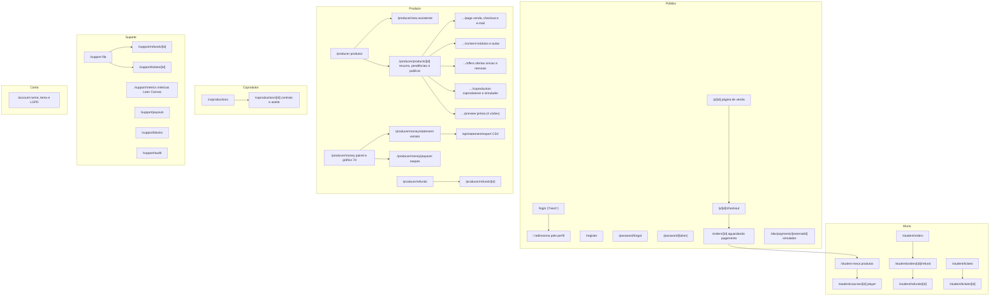

# Plano do frontend

Mapa de telas do MVP, dividido em lotes pequenos. Cada lote é um PR: fecha telas inteiras, ligadas aos serviços reais de `src/lib/server/services`, com testes. A porcentagem é o avanço acumulado do frontend ao fim do lote.

O backend já existe, então cada tela nasce ligada ao seu serviço (`load` e ações de formulário com `act()`). A fase final junta as jornadas completas entre perfis, fecha buracos de navegação e faz a revisão geral.

## 1. Definição de pronto de uma tela

Uma tela só conta como pronta quando cumpre tudo abaixo.

| Item | Critério |
| --- | --- |
| Kit | Só componentes de `#lib/ui`; peça nova segue `docs/design/README.md` seção 4 |
| Estados | Carregando (`Skeleton`), vazio (`EmptyState`), erro (`Alert` com o código traduzido), sucesso (`Toast` ou mudança visível) |
| Formulário | Funciona sem JavaScript; com JS usa `use:enhance`, mostra `loading` no botão e erro no campo certo |
| Responsivo | Revisada em 375 px e em desktop; checkout e área do aluno pensados primeiro para celular (RNF-08) |
| Tema | Revisada em claro e escuro |
| Acessibilidade | Navegável só por teclado, foco visível, rótulos, sem violação do axe |
| Acesso | Rota checa papel e dono no servidor (RNF-05); recurso de outra pessoa responde 404 |
| Testes | Lógica pura nova com Vitest; e2e Playwright do caminho feliz e de um caminho de erro; e2e de acesso negado quando a tela é de um perfil |
| Revisão | Captura das telas (mobile e desktop) na descrição do PR |

## 2. Mapa de rotas

Uma conta pode ter vários perfis (RF-04). O `Shell` traz a marca no topo, barra compacta sem estouro horizontal em 375 px e seções na barra lateral para cada perfil que a pessoa tem (Produtor sempre, Aluno se tem matrícula ou pedido, Coprodução se tem convite, Suporte só para `support`), com contadores ao vivo de itens pendentes (`listPendingCounts`).

## 3. Lotes

### Fase 0. Fundação (0 a 10%)

| Lote | Entrega | % |
| --- | --- | --- |
| 0.1 | Playwright instalado, banco de teste isolado, fixtures que criam usuário, produto publicado e compra pelos serviços (`services/testing.ts`), login por fixture, axe; job no CI | 4 |
| 0.2 | Tradução de `DomainErrorCode` para português num só lugar, com teste que falha se faltar código; padrão de formulário (`act()` + `use:enhance` + erro por campo) | 7 |
| 0.3 | Layout autenticado com `Shell` e navegação por perfil, `Toast` montado, páginas de erro 404 e 500, guarda de papel por grupo de rota (`producer`, `student`, `support`) | 10 |

Concluída em 10/11/2026. Como ficou: `convencoes.md` seção 6. Duas decisões no caminho: o botão de sair fica na página da conta (lote 1.2), porque o catálogo reserva `NavItem` para navegação; e o texto secundário claro do kit subiu de 60% para 76% de opacidade para passar no contraste AA do axe (`design/cores.md`).

### Fase 1. Conta e acesso (10 a 17%)

| Lote | Telas | Serviços | % |
| --- | --- | --- | --- |
| 1.1 | `/login`, `/register` migradas para o kit (sai a isenção do ESLint), `/` redireciona pelo perfil | `startSession`, `findOrCreateAccount` | 13 |
| 1.2 | `/password/forgot`, `/password/[token]` (primeira senha e recuperação), `/account` com sair | `requestPasswordReset`, `setPasswordWithToken` | 17 |

E2e: cadastrar, entrar, sair; senha errada; link expirado; usuário logado sem papel de suporte recebe 404 em `/support`.

Concluída em 10/11/2026 e expandida no passe MVP de Ouro (17/11/2026). Cadastro e login ficam em `auth/accounts.ts` (`register`, `authenticate`), com o código `invalid_credentials`. Um e-mail que já tem conta sem senha (comprador ou convidado) conta como ocupado: a pessoa entra pelo link de senha, nunca se cadastrando de novo. `/` usa `homeProfile`, e `/login` aceita `?next=` validado por `safeNext` (apenas caminhos internos) com cabeçalho da marca também em `/register`. Em `/account`, a pessoa edita o próprio nome (`updateUserName`), escolhe o tema (`system`, `light` ou `dark`, gravado no cookie `cakto_theme` e injetado no SSR em `hooks.server.ts`), encerra a conta em dois passos segundo a LGPD (`closeAccount`, RNF-06: exige senha, recusa com `account_has_open_obligations` se houver saldo, saque, reembolso ou bloqueio em aberto, e apaga ou anonimiza conforme haja histórico) e sai da sessão.

### Fase 2. Criação do produto, UC-01 (17 a 42%)

| Lote | Telas | Serviços | % |
| --- | --- | --- | --- |
| 2.1 | `/producer`: lista com estado, aulas, vendas, preço e ação principal; vazio leva ao assistente | `listProducerProducts` | 20 |
| 2.2 | `/producer/new`: assistente com `Stepper`, uma pergunta por passo (tipo, nome, preço, público, marca com `ColorField`, fonte e URL da logo) | `createProductSchema`, `brandSchema` | 26 |
| 2.3 | Último passo do assistente: escolha de modelo com prévia já com a marca; confirma e gera o rascunho | `listTemplates`, `createProduct` | 29 |
| 2.4 | `/producer/products/[id]`: visão geral com `Tabs` e dados básicos editáveis com prévia ao vivo | `getProductEditor`, `updateProduct` | 32 |
| 2.5 | `…/page`: seções em `Disclosure` para `sales`, `checkout` e `access_email`, edição de texto, imagem e ordem | `updatePage` | 35 |
| 2.6 | `…/content`: módulos e aulas, criar, renomear, apagar, reordenar; aula com URL do vídeo, texto e URL do anexo | `addModule` … `reorderLessons` | 39 |
| 2.7 | `…/offers` e publicação: ofertas únicas e mensais; `Checklist` de pendências com link para cada uma, Publicar só sem pendências | `addOffer`, `updateOffer`, `deleteOffer`, `publishProduct` | 42 |

E2e UC-01: do assistente ao produto publicado; Publicar bloqueado com pendência; produtor B recebe 404 no editor do produtor A.

Concluída em 12/11/2026 e expandida em 17/11/2026. A migração `0005_seed_templates_extra.sql` adicionou os modelos `subscription-club` (`Clube de assinatura`, tipo `subscription`) e `workshop` (`Oficina prática`, tipo `course`) aos modelos `online-course` e `mentorship`. Ofertas aceitam cobrança única (`one_time`) ou mensal (`monthly`, decisão D5), já criada como mensal nos produtos de assinatura. Na lista `/producer`, cada cartão mostra `lessonCount` e `paidOrderCount`. No resumo do editor publicado aparece um `CopyField` com o endereço público da página de venda, e na aba `Dados básicos` um `BrandHero` atualiza ao vivo enquanto o produtor edita nome, cor, fonte e logo. Em `…/page`, uma navegação alterna entre `Página de venda`, `Checkout` e `E-mail de acesso` (`?type=sales|checkout|access_email`).

### Fase 3. Venda, UC-02 (42 a 54%)

| Lote | Telas | Serviços | % |
| --- | --- | --- | --- |
| 3.1 | `/p/[id]`: página de venda pública com a marca do produtor, rápida no celular (RNF-07) | `getSalesPage` | 46 |
| 3.2 | `/p/[id]/checkout?offer=…`: dados mínimos, máscara CPF/CNPJ, política de reembolso, Pix ou cartão | `getCheckout`, `startCheckout` | 50 |
| 3.3 | `/orders/[id]`: aguardando pagamento com Pix copia e cola (`CopyField`), atualização do status e confirmação que leva à área do aluno; `/dev/payments/[externalId]` em desenvolvimento | `getPaymentStatus`, rota `api/dev/payments` | 54 |

E2e UC-02: comprar com Pix, simular pagamento, cair na área do aluno; cartão recusado; Pix expirado; produto não publicado dá 404.

Concluída em 12/11/2026 e polida em 17/11/2026. As três telas públicas vestem a marca do produtor pelo `BrandScope` e exibem selo de assinatura mensal e `/mês` nas ofertas recorrentes. No checkout, o campo de CPF/CNPJ formata progressivamente conforme os dígitos (`000.000.000-00` ou `00.000.000/0000-00`) e um `Disclosure` mostra a política de reembolso antes do pagamento. Em `/orders/[id]`, aparece a logo da marca quando configurada e, após pago, o botão secundário `Ver meus pedidos` ao lado de `Ir para meus produtos`. O adaptador real `asaasGateway` (`payment/asaas.ts`) e o `resendMailer` (`email/resend.ts`) entram automaticamente em `server/app.ts` quando as variáveis de ambiente opcionais estão preenchidas.

### Fase 4. Aluno, UC-03 e UC-04 (54 a 68%)

| Lote | Telas | Serviços | % |
| --- | --- | --- | --- |
| 4.1 | `/student`: produtos com tipo e progresso | `listMyProducts` | 57 |
| 4.2 | `/student/courses/[id]`: player com `VideoFrame`, contador, anterior/próxima e `LessonList` | `getCourse`, `setLessonDone` | 61 |
| 4.3 | `/student/orders`, `/student/orders/[id]/refund`: pedidos com retomada de pagamento, acesso e reembolso | `listMyOrders`, `requestRefund` | 64 |
| 4.4 | `/student/refunds/[id]`: `Timeline` das etapas, responsável atual, prazo, conversa com `Message`, contestar | `getRefund`, `addRefundMessage`, `contestRefund` | 66 |
| 4.5 | `/student/tickets` e `/student/tickets/[id]`: abrir chamado ligado a um pedido, nome do produto e conversa (RF-35, S) | `openTicket`, `listMyTickets`, `getTicket`, `addTicketMessage`, `closeTicket` | 68 |

E2e UC-04: dentro da garantia aprova sozinho e o acesso some; fora da garantia fica com o produtor, envia aviso por e-mail e mostra prazo; aluno B recebe 404 no reembolso do aluno A.

Concluída em 13/11/2026 e polida em 17/11/2026. Os cartões em `/student` mostram o ícone e o rótulo do tipo do produto (`Curso`, `Mentoria`, `Assinatura`). No player (`/student/courses/[id]`), o cabeçalho mostra `{moduleTitle} · Aula X de Y`, há navegação `Aula anterior` e `Próxima aula`, e ao atingir 100% aparece o alerta `Curso concluído!`. Em `/student/orders`, pedidos `pending` trazem o botão `Concluir pagamento` apontando para `/orders/[id]`. Em `/student/tickets`, `listMyTickets` traz `productName` e cada cartão mostra o produto correspondente.

### Fase 5. Dinheiro, UC-07 (68 a 78%)

| Lote | Telas | Serviços | % |
| --- | --- | --- | --- |
| 5.1 | `/producer/money`: três `Stat` (retido, liberado, sacado), gráfico de receita líquida de 7 dias, `Timeline` das próximas liberações e `Alert` de bloqueio (RF-45) | `getMoneyPanel` | 72 |
| 5.2 | `/producer/money/statement` e `/api/statement/export`: extrato em `Table` com filtros, total/páginas e exportação CSV; serve também ao coprodutor (RF-53) | `getStatement`, `listStatementProducts` | 75 |
| 5.3 | `/producer/money/payouts`: histórico e `Dialog` de saque com taxa antes de confirmar | `listPayouts`, `previewPayout`, `requestPayout` | 78 |

E2e UC-07: venda aparece retida com data e no gráfico de 7 dias; job diário libera; saque mostra taxa e entra no histórico; saldo bloqueado impede saque e mostra o motivo; exportação CSV respeita filtros e isola contas.

Concluída em 13/11/2026 e expandida em 17/11/2026. O painel `/producer/money` ganhou o cartão "Desempenho dos últimos 7 dias" com `Chart` de barras da receita líquida diária em `America/Sao_Paulo` (`recentSales`). No extrato, `getStatement` devolve `totalCount` e `pageCount`, exibindo `Mostrando X de Y lançamentos`, `Página X de Y` e o botão `Exportar CSV` com os filtros ativos. A rota `GET /api/statement/export` gera um CSV UTF-8 com BOM, separador `;`, datas em `America/Sao_Paulo` e sanitização contra injeção de fórmulas em planilhas.

### Fase 6. Reembolso do lado do produtor, UC-05 (78 a 82%)

| Lote | Telas | Serviços | % |
| --- | --- | --- | --- |
| 6.1 | `/producer/refunds` e `/producer/refunds/[id]`: fila ordenada pelo prazo, aprovar ou recusar com justificativa, conversa | `listProducerRefunds`, `getRefund`, `producerDecision`, `addRefundMessage` | 82 |

E2e UC-05: produtor recusa com justificativa e o aluno vê; produtor aprova e o lançamento é estornado.

Concluída em 13/11/2026 e completada em 17/11/2026. Quando o aluno pede reembolso fora da garantia (`with_producer`), `requestRefund` envia um e-mail transacional ao produtor informando o prazo de 3 dias corridos e o link direto para `/producer/refunds/[id]`. Além disso, a barra lateral do `Shell` mostra o contador ao vivo de reembolsos aguardando decisão do produtor (`listPendingCounts`).

### Fase 7. Coprodução, UC-08 e UC-09 (82 a 88%)

| Lote | Telas | Serviços | % |
| --- | --- | --- | --- |
| 7.1 | `…/coproduction` no editor: convidar por e-mail com percentual e duração, simulador ao vivo de venda, status do aceite, cancelar | `inviteCoproducer`, `listProductCoproductions`, `cancelInvite` | 85 |
| 7.2 | `/coproductions` e `/coproductions/[id]`: contrato com o texto versionado e aceite | `listMyCoproductions`, `getContract`, `acceptInvite` | 88 |

E2e UC-08 e UC-09: convite, aceite, venda, extrato do coprodutor com bruto, taxa, parte do produtor e a dele; venda anterior ao aceite não aparece.

Concluída em 13/11/2026 e completada em 17/11/2026. Em `…/coproduction`, a simulação continua funcionando sem JavaScript por formulário GET (`?percent=&offer=`), mas com JavaScript atualiza os 4 cartões `Stat` (`simulateSale`) em tempo real conforme o produtor digita o percentual ou troca a oferta, já preenchendo o campo de percentual do convite. A barra lateral exibe o contador de convites pendentes para o coprodutor, e o login preserva `?next=`.

### Fase 8. Suporte, UC-06 (88 a 95%)

| Lote | Telas | Serviços | % |
| --- | --- | --- | --- |
| 8.1 | `/support`: fila de reembolsos escalados, chamados e aviso de saques pendentes | `getSupportQueue` | 90 |
| 8.2 | `/support/refunds/[id]` e `/support/tickets/[id]`: decisão com justificativa, conversa, encerrar chamado | `supportDecision`, `getTicket`, `addTicketMessage`, `closeTicket` | 92 |
| 8.3 | `/support/blocks` e `/support/audit`: bloquear e desbloquear saldo, conta ou produto com motivo obrigatório; auditoria | `createBlock`, `liftBlock`, `listActiveBlocks`, `listAuditTrail` | 94 |
| 8.4 | `/support/payouts` e `/support/metrics`: concluir ou recusar saques; métricas Lean Canvas e operacionais | `completePayout`, `declinePayout`, `getPlatformMetrics` | 95 |

E2e UC-06: reembolso vencido escala, suporte decide, aluno e produtor veem; bloqueio aparece no painel do produtor com o motivo; toda ação aparece na auditoria; painel de métricas e alerta de saques operacionais.

Concluída em 13/11/2026 e expandida em 17/11/2026. A barra lateral do suporte traz `Fila` (com contador de reembolsos + chamados), `Métricas`, `Saques` (com contador de saques solicitados), `Bloqueios` e `Auditoria`. Na `Fila` (`/support`), quando há saques aguardando transferência, um `Alert` leva direto a `/support/payouts`. Em `/support/metrics`, `getPlatformMetrics` consolida os indicadores do Lean Canvas (mediana de horas até publicar o 1º produto, taxa de publicação, mediana até a 1ª resposta em reembolso e total/abertos de chamados), o resumo financeiro/operacional (volume pago, receita de taxas, pedidos pagos, bloqueios ativos), o `Chart` de pedidos pagos dos últimos 7 dias e a tabela de chamados por produtor.

### Fase 9. Integração e fechamento (95 a 100%)

| Lote | Entrega | % |
| --- | --- | --- |
| 9.1 | Jornadas completas entre perfis num só e2e: produtor cria e publica, aluno compra e assiste, pede reembolso, produtor não responde, suporte decide, dinheiro bate | 97 |
| 9.2 | Navegação e links cruzados revisados, todos os e-mails apontando para rotas reais, `…/preview` em 4 visões (RF-16) | 98 |
| 9.3 | Revisão geral: axe em todas as rotas, LCP das páginas públicas, varredura de acesso e de exportação CSV, capturas finais | 99 |
| 9.4 | Teste de uso com 3 a 5 pessoas não técnicas criando o primeiro produto; ajustes do que travou | 100 |

Lotes 9.1 a 9.3 concluídos em 13/11/2026 e atualizados com as rotas e fluxos do passe MVP de Ouro em 17/11/2026. O 9.4 depende de pessoas reais e tem roteiro pronto em `docs/produto/teste-de-uso.md`.

9.1: `e2e/journey.spec.ts` percorre a jornada inteira pelas telas reais, em duas variantes (o suporte aprova ou recusa). O dinheiro bate nos dois desfechos: aprovado zera o retido e deixa só a taxa fixa de R$ 2,49 com a plataforma; recusado mantém o líquido retido e o acesso do aluno.

9.2: os quatro e-mails transacionais (redefinição de senha, acesso da compra, convite de coprodução e aviso ao produtor de reembolso fora da garantia) têm os links conferidos contra a lista de rotas e a origem `APP_URL` (`src/lib/server/email-links.int.test.ts`). `e2e/navigation.spec.ts` segue, por perfil, todos os links internos visíveis (incluindo `/support/metrics`) sem achar link quebrado. `…/preview` (RF-16) mostra em modo somente leitura as 4 pontas do produto: `Página de venda`, `Checkout`, `E-mail de acesso` e `Conteúdo do curso`.

9.3: axe sem violação em todas as rotas (incluindo `/support/metrics`), nos temas claro e escuro (`e2e/review-a11y.spec.ts`). A varredura de acesso (`e2e/review-access.spec.ts`) cobre todas as rotas de `(app)`, a exportação `GET /api/statement/export` (anônimo vai para `/login`, outros usuários nunca veem vendas alheias) e mais de 90 POSTs contra recursos de outras pessoas: tudo responde 404 e o banco não muda. Os dois specs têm guarda automática contra rotas novas sem cobertura. `e2e/review-captures.spec.ts` salva as capturas finais em desktop e 375 px (incluindo prévia e métricas). LCP público medido entre 376 e 440 ms (`pnpm test:review`). Gates na main [measured]: `pnpm lint`, `pnpm check`, 276 testes unitários, 129 de integração e 289 e2e aprovados (+ 1 ignorado no mobile).

## 4. Ordem e dependências

As fases seguem a ordem dos dados: sem produto publicado não há venda, sem venda não há dinheiro nem reembolso. As fixtures do lote 0.1 criam esses dados direto pelos serviços, então cada spec roda isolado e em paralelo.

## 5. Decisões

| # | Decisão |
| --- | --- |
| F1 | Em aberto: logo e anexos ficam só por URL (`brandSchema`, `lessonSchema`) no MVP ou entra armazenamento de arquivo para usar `FileUpload`? |
| F2 | Decidida em 13/11/2026: quem conclui o saque é o suporte, em `/support/payouts` (lote 8.4). |
| F3 | Decidida em 12/11/2026: `/orders/[id]` consulta o status periodicamente a cada 4 s enquanto o pedido está pendente. |
