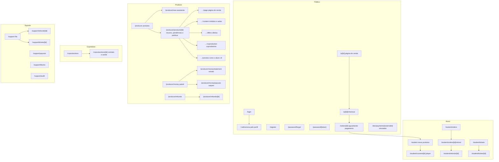

# Plano do frontend

Mapa de telas do MVP, dividido em lotes pequenos. Cada lote é um PR: fecha telas inteiras, ligadas aos serviços reais de `src/lib/server/services`, com testes. A porcentagem é o avanço acumulado do frontend ao fim do lote.

O backend já existe, então cada tela nasce ligada ao seu serviço (`load` e ações de formulário com `act()`). A fase final não liga telas: junta as jornadas completas entre perfis, fecha buracos de navegação e faz a revisão geral.

## 1. Definição de pronto de uma tela

Uma tela só conta como pronta quando cumpre tudo abaixo.

| Item | Critério |
| --- | --- |
| Kit | Só componentes de `#lib/ui`; peça nova segue `docs/design/README.md` seção 4 |
| Estados | Carregando (`Skeleton`), vazio (`EmptyState`), erro (`Alert` com o código traduzido), sucesso (`Toast` ou mudança visível) |
| Formulário | Funciona sem JavaScript; com JS usa `use:enhance`, mostra `loading` no botão e erro no campo certo |
| Responsivo | Revisada em 375 px e em desktop; checkout e área do aluno pensados primeiro para celular (RNF-08) |
| Tema | Revisada em claro e escuro |
| Acessibilidade | Navegável só por teclado, foco visível, rótulos, sem violação do axe |
| Acesso | Rota checa papel e dono no servidor (RNF-05); recurso de outra pessoa responde 404 |
| Testes | Lógica pura nova com Vitest; e2e Playwright do caminho feliz e de um caminho de erro; e2e de acesso negado quando a tela é de um perfil |
| Revisão | Captura das telas (mobile e desktop) na descrição do PR |

## 2. Mapa de rotas

Uma conta pode ter vários perfis (RF-04). O `Shell` mostra na barra lateral as seções de cada perfil que a pessoa tem: Produtor sempre, Aluno se tem matrícula ou pedido, Coprodução se tem convite, Suporte só para `support`.

## 3. Lotes

### Fase 0. Fundação (0 a 10%)

| Lote | Entrega | % |
| --- | --- | --- |
| 0.1 | Playwright instalado, banco de teste isolado, fixtures que criam usuário, produto publicado e compra pelos serviços (`services/testing.ts`), login por fixture, axe; job no CI | 4 |
| 0.2 | Tradução de `DomainErrorCode` para português num só lugar, com teste que falha se faltar código; padrão de formulário (`act()` + `use:enhance` + erro por campo) | 7 |
| 0.3 | Layout autenticado com `Shell` e navegação por perfil, `Toast` montado, páginas de erro 404 e 500, guarda de papel por grupo de rota (`producer`, `student`, `support`) | 10 |

Concluída em 10/11/2026. Como ficou: `convencoes.md` seção 6. Duas decisões no caminho: o botão de sair fica na página da conta (lote 1.2), porque o catálogo reserva `NavItem` para navegação; e o texto secundário claro do kit subiu de 60% para 76% de opacidade para passar no contraste AA do axe (`design/cores.md`). As telas de `/producer`, `/student`, `/coproductions` e `/support` são provisórias até os lotes 2.1, 4.1, 7.2 e 8.1.

### Fase 1. Conta e acesso (10 a 17%)

| Lote | Telas | Serviços | % |
| --- | --- | --- | --- |
| 1.1 | `/login`, `/register` migradas para o kit (sai a isenção do ESLint), `/` redireciona pelo perfil | `startSession`, `findOrCreateAccount` | 13 |
| 1.2 | `/password/forgot`, `/password/[token]` (primeira senha e recuperação), `/account` com sair | `requestPasswordReset`, `setPasswordWithToken` | 17 |

E2e: cadastrar, entrar, sair; senha errada; link expirado; usuário logado sem papel de suporte recebe 404 em `/support`.

Concluída em 10/11/2026. Cadastro e login saíram das rotas para `auth/accounts.ts` (`register`, `authenticate`), com o código novo `invalid_credentials`. Um e-mail que já tem conta sem senha (comprador ou convidado) conta como ocupado: a pessoa entra pelo link de senha, nunca se cadastrando de novo. `/` usa `homeProfile`: suporte vai para a fila; quem só comprou ou foi convidado, sem produto próprio, vai para essa área; o resto vai para Produtos. A página do link (`passwordTokenOwner`) já diz na abertura se o link expirou e se é a primeira senha. No caminho, o link e o texto de erro do kit passaram a ter contraste AA nos dois temas (`design/cores.md`).

### Fase 2. Criação do produto, UC-01 (17 a 42%)

| Lote | Telas | Serviços | % |
| --- | --- | --- | --- |
| 2.1 | `/producer`: lista com estado, preço e ação principal; vazio leva ao assistente | `listProducerProducts` | 20 |
| 2.2 | `/producer/new`: assistente com `Stepper`, uma pergunta por passo (tipo, nome, preço, público, marca com `ColorField`, fonte e URL da logo) | `createProductSchema`, `brandSchema` | 26 |
| 2.3 | Último passo do assistente: escolha de modelo com prévia já com a marca; confirma e gera o rascunho | `listTemplates`, `createProduct` | 29 |
| 2.4 | `/producer/products/[id]`: visão geral com `Tabs` e dados básicos editáveis | `getProductEditor`, `updateProduct` | 32 |
| 2.5 | `…/page`: seções da página de venda em `Disclosure`, edição de texto, imagem e ordem | `updatePage` | 35 |
| 2.6 | `…/content`: módulos e aulas, criar, renomear, apagar, reordenar; aula com URL do vídeo, texto e URL do anexo | `addModule` … `reorderLessons` | 39 |
| 2.7 | `…/offers` e `…/publish`: ofertas; `Checklist` de pendências com link para cada uma, Publicar só sem pendências | `addOffer`, `updateOffer`, `deleteOffer`, `publishProduct` | 42 |

E2e UC-01: do assistente ao produto publicado; Publicar bloqueado com pendência; produtor B recebe 404 no editor do produtor A.

`…/preview` (RF-16, prioridade S) entra no lote 9.2 se houver tempo.

Concluída em 12/11/2026. Publicar não ganhou rota própria: o `Checklist` de pendências e o botão Publicar ficam no resumo do editor, que já era a tela das pendências, e cada pendência leva à tela que a resolve. O botão fica desativado enquanto houver pendência, e o servidor confere de novo ao publicar. As telas com vários formulários (conteúdo, ofertas) respondem pelo mesmo padrão de `answer.ts`: cada resposta diz a que formulário pertence, e o erro aparece nele.

### Fase 3. Venda, UC-02 (42 a 54%)

| Lote | Telas | Serviços | % |
| --- | --- | --- | --- |
| 3.1 | `/p/[id]`: página de venda pública com a marca do produtor, rápida no celular (RNF-07) | `getSalesPage` | 46 |
| 3.2 | `/p/[id]/checkout?offer=…`: dados mínimos, CPF validado, Pix ou cartão | `getCheckout`, `startCheckout` | 50 |
| 3.3 | `/orders/[id]`: aguardando pagamento com Pix copia e cola (`CopyField`), atualização do status e confirmação que leva à área do aluno; `/dev/payments/[externalId]` para aprovar ou recusar em desenvolvimento | `getPaymentStatus`, rota `api/dev/payments` | 54 |

E2e UC-02: comprar com Pix, simular pagamento, cair na área do aluno; cartão recusado; Pix expirado; produto não publicado dá 404.

Concluída em 12/11/2026. O produto não tem slug, então as rotas públicas usam o id (`/p/[id]`); um id malformado também dá 404. A oferta vai no endereço (`?offer=`), e a página de venda leva direto a ela quando só há uma. As três telas públicas vestem a marca do produtor pelo `BrandScope` (componente novo do kit): cor de destaque, texto legível sobre ela e fonte. O cartão é digitado na página do meio de pagamento, nunca aqui; em desenvolvimento essa página é o simulador. F3 ficou com a consulta periódica: `/orders/[id]` pergunta o status a cada 4 s enquanto o pedido está pendente. Ainda falta tratar o retorno do cartão de um provedor real, que entra com a integração dele.

### Fase 4. Aluno, UC-03 e UC-04 (54 a 68%)

| Lote | Telas | Serviços | % |
| --- | --- | --- | --- |
| 4.1 | `/student`: produtos com progresso | `listMyProducts` | 57 |
| 4.2 | `/student/courses/[id]`: player com `VideoFrame` e `LessonList`, marcar aula como concluída | `getCourse`, `setLessonDone` | 61 |
| 4.3 | `/student/orders`, `/student/orders/[id]/refund`: pedidos com status de pagamento e acesso; pedido de reembolso com motivo | `listMyOrders`, `requestRefund` | 64 |
| 4.4 | `/student/refunds/[id]`: `Timeline` das etapas, responsável atual, prazo, conversa com `Message`, contestar | `getRefund`, `addRefundMessage`, `contestRefund` | 66 |
| 4.5 | `/student/tickets` e `/student/tickets/[id]`: abrir chamado ligado a um pedido, conversa (RF-35, S) | `openTicket`, `listMyTickets`, `getTicket`, `addTicketMessage`, `closeTicket` | 68 |

E2e UC-04: dentro da garantia aprova sozinho e o acesso some; fora da garantia fica com o produtor e mostra prazo; aluno B recebe 404 no reembolso do aluno A.

Concluída em 13/11/2026. Nenhum serviço mudou. O player guarda a aula no endereço (`?lesson=`); sem ela, abre a primeira não concluída, ou a primeira quando todas já foram. Marcar como concluída é um formulário que funciona sem JavaScript. O `LessonList` ganhou `href`, para cada aula ser um link, e passou a anunciar ao leitor de tela qual aula foi concluída. YouTube e Vimeo tocam num iframe (YouTube pelo `youtube-nocookie.com`), arquivo de vídeo toca em `<video>`, e outro endereço vira um link "Abrir vídeo". Acesso revogado dá 404 no curso. O reembolso não tem histórico gravado, então a `Timeline` deriva as etapas de `status`, `contested` e `declineReason`. O cartão do pedido leva ao curso, ao reembolso e a um chamado sobre aquele pedido (`/student/tickets/new?order=`). Abrir chamado tem página própria, e chamado fechado não aceita mais mensagens. O texto secundário da `Timeline` e do contador do `LessonList` subiu de terciário para secundário, para passar no AA. No caminho: os specs esperam a hidratação (`hydrated` em `e2e/fixtures.ts`) antes de mexer num `select`, e `E2E_PORT` deixa várias worktrees rodarem o e2e ao mesmo tempo. Ficou de fora: a lista de chamados não mostra o produto do pedido, porque `listMyTickets` não traz o nome dele.

### Fase 5. Dinheiro, UC-07 (68 a 78%)

| Lote | Telas | Serviços | % |
| --- | --- | --- | --- |
| 5.1 | `/producer/money`: três `Stat` (retido, liberado, sacado), `Timeline` das próximas liberações com motivo e data, `Alert` de bloqueio com motivo e caminho (RF-45) | `getMoneyPanel` | 72 |
| 5.2 | `/producer/money/statement`: extrato em `Table` com filtros na URL (produto, período, status) e a regra aplicada em cada linha; serve também ao coprodutor (RF-53) | `getStatement` | 75 |
| 5.3 | `/producer/money/payouts`: histórico e `Dialog` de saque com taxa antes de confirmar | `listPayouts`, `previewPayout`, `requestPayout` | 78 |

E2e UC-07: venda aparece retida com data; job diário libera; saque mostra taxa e entra no histórico; saldo bloqueado impede saque e mostra o motivo.

### Fase 6. Reembolso do lado do produtor, UC-05 (78 a 82%)

| Lote | Telas | Serviços | % |
| --- | --- | --- | --- |
| 6.1 | `/producer/refunds` e `/producer/refunds/[id]`: fila ordenada pelo prazo, aprovar ou recusar com justificativa, conversa | `listProducerRefunds`, `getRefund`, `producerDecision`, `addRefundMessage` | 82 |

E2e UC-05: produtor recusa com justificativa e o aluno vê; produtor aprova e o lançamento é estornado.

### Fase 7. Coprodução, UC-08 e UC-09 (82 a 88%)

| Lote | Telas | Serviços | % |
| --- | --- | --- | --- |
| 7.1 | `…/coproduction` no editor: convidar por e-mail com percentual e duração, simulação de uma venda, status do aceite, cancelar | `inviteCoproducer`, `listProductCoproductions`, `cancelInvite` | 85 |
| 7.2 | `/coproductions` e `/coproductions/[id]`: contrato com o texto versionado e aceite | `listMyCoproductions`, `getContract`, `acceptInvite` | 88 |

E2e UC-08 e UC-09: convite, aceite, venda, extrato do coprodutor com bruto, taxa, parte do produtor e a dele; venda anterior ao aceite não aparece.

### Fase 8. Suporte, UC-06 (88 a 95%)

| Lote | Telas | Serviços | % |
| --- | --- | --- | --- |
| 8.1 | `/support`: fila de reembolsos escalados e chamados, ordenada pelo prazo | `getSupportQueue` | 90 |
| 8.2 | `/support/refunds/[id]` e `/support/tickets/[id]`: decisão com justificativa, conversa, encerrar chamado | `supportDecision`, `getTicket`, `addTicketMessage`, `closeTicket` | 92 |
| 8.3 | `/support/blocks` e `/support/audit`: bloquear e desbloquear saldo ou produto com motivo obrigatório; auditoria | `createBlock`, `liftBlock`, `activeBlocks`, `listAudit` | 94 |
| 8.4 | `/support/payouts`: concluir ou recusar saques (hoje `completePayout` e `declinePayout` não têm tela) | `completePayout`, `declinePayout` | 95 |

E2e UC-06: reembolso vencido escala, suporte decide, aluno e produtor veem; bloqueio aparece no painel do produtor com o motivo; toda ação aparece na auditoria.

### Fase 9. Integração e fechamento (95 a 100%)

| Lote | Entrega | % |
| --- | --- | --- |
| 9.1 | Jornadas completas entre perfis num só e2e: produtor cria e publica, aluno compra e assiste, pede reembolso, produtor não responde, suporte decide, dinheiro bate | 97 |
| 9.2 | Navegação e links cruzados revisados, e-mails apontando para as rotas certas, `…/preview` (RF-16) se couber | 98 |
| 9.3 | Revisão geral: axe em todas as rotas, LCP das páginas públicas, varredura de acesso (cada rota com usuário de outro perfil e de outro dono), capturas finais | 99 |
| 9.4 | Teste de uso com 3 a 5 pessoas não técnicas criando o primeiro produto; ajustes do que travou | 100 |

## 4. Ordem e dependências

As fases seguem a ordem dos dados: sem produto publicado não há venda, sem venda não há dinheiro nem reembolso. As fixtures do lote 0.1 criam esses dados direto pelos serviços, então dá para adiantar uma fase se for preciso, mas o e2e de cada fase usa as telas das anteriores sempre que elas já existem.

## 5. Decisões em aberto

| # | Decisão |
| --- | --- |
| F1 | Logo e anexos: o backend guarda só URL (`brandSchema`, `lessonSchema`). Fica assim no MVP ou entra armazenamento de arquivo para usar o `FileUpload`? |
| F2 | `/support/payouts` (lote 8.4) é do suporte ou o simulador conclui o saque sozinho? |