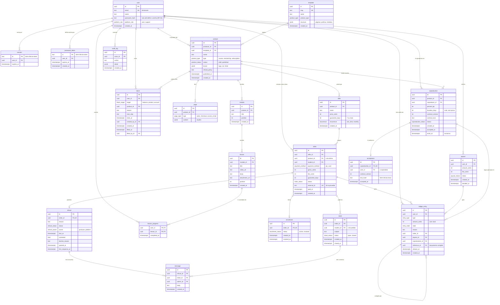

# Modelo de dados

Banco PostgreSQL, acessado por Drizzle. Valores em centavos inteiros (RNF-01). Datas em `timestamptz`, em UTC (RNF-11). O texto é em português; tabelas, colunas e valores aparecem com os nomes reais do banco, em inglês (glossário em `convencoes.md`).

Fonte de verdade: `src/lib/server/db/schema.ts` (tabelas, restrições e índices) e `drizzle/0002_integrity_triggers.sql` (gatilhos). Os testes de cada regra estão em `src/lib/server/db/schema.int.test.ts`. Mudou o modelo, atualize este documento no mesmo commit.

## 1. Diagrama entidade-relacionamento



## 2. Decisões do modelo

- **Papéis não são tipos de conta (RF-04).** Produtor, aluno e coprodutor são relações com um produto. Só `platform_role` distingue o suporte.
- **Conta sem senha (RF-03).** O aluno criado no checkout e o coprodutor convidado por e-mail recebem uma conta com `password_hash` nulo e um `password_token` para definir a senha. O mesmo token serve para recuperar a senha (RF-02). O login já recusa conta sem senha.
- **Bloqueio não é status do produto.** `product.status` é só `draft` ou `published`. Bloqueio de produto, saldo ou conta é uma linha em `block`, com motivo e próximo passo (RN-11). Vale enquanto `lifted_at` for nulo e `ends_at` for nulo ou futuro. Assim existe um único lugar que diz se algo está bloqueado.
- **O pedido guarda a foto da venda.** `gross_cents`, `fee_cents` e `guarantee_days` são copiados da oferta no checkout. Mudar a oferta depois não reescreve vendas antigas. O `product_id` do pedido é o da oferta (chave estrangeira composta) e permite filtrar o extrato por produto (RF-43).
- **Progresso por aluno e aula.** `lesson_progress` usa `(user_id, lesson_id)`, não a matrícula. Quem compra de novo o mesmo produto não perde o progresso. O acesso continua decidido pela matrícula ativa.
- **Um pedido de reembolso por pedido.** A RN-09 permite uma contestação, não um segundo pedido.
- **Chamados (RF-35, RF-60).** `ticket` é ligado a um pedido do próprio aluno. A conversa de reembolso e a de chamado usam a mesma tabela `message`, sempre presa a exatamente uma das duas.
- **Coprodução por versão.** Cada linha de `coproduction` é uma versão das condições. Mudar o percentual cria uma nova linha (convite). No aceite, a versão anterior termina no mesmo instante (`ends_at`), então duas versões nunca valem juntas. Uma versão vale para vendas com `accepted_at <= pago_em < ends_at` (`termsInForce` em `domain/coproduction.ts`).
- **Exclusão de conta (RNF-06).** Sessões, tokens e progresso somem junto com o usuário. Registros financeiros e de auditoria impedem a exclusão (`ON DELETE` restrito): para esses casos a exclusão vira anonimização, a definir antes de dados reais.

## 3. Restrições de integridade

Tudo abaixo é garantido pelo banco, não só pelo código. Erros de regra usam o SQLSTATE `23514` (`check_violation`).

| Regra | Como o banco garante |
| --- | --- |
| Pedido pago uma vez por cobrança (RN-15) | `UNIQUE (order.external_id)` |
| Uma matrícula por pedido | `UNIQUE (enrollment.order_id)` |
| Pedido aponta para o produto da sua oferta | FK composta `(offer_id, product_id)` para `offer` |
| `paid_at` existe só em pedido pago ou reembolsado | `CHECK order_paid_at` |
| Taxa entre zero e o valor bruto | `CHECK order_fee_within_gross` |
| Preço mínimo da oferta **(hipótese)** e garantia de ao menos 7 dias (RN-03) | `CHECK offer_price_min`, `offer_guarantee_min`, `order_guarantee_min`, valores de `domain/params.ts` |
| Produto publicado tem data de publicação | `CHECK product_published_at` |
| Uma página de cada tipo por produto | `UNIQUE (page.product_id, type)` |
| Lançamentos imutáveis (RN-14) | Gatilho `ledger_entry_guard`: só `state` muda, nas transições de `ENTRY_TRANSITIONS`; nada é apagado |
| Sinal, estado e vínculos de cada tipo de lançamento | `CHECK ledger_entry_amount_sign`, `ledger_entry_state_by_type`, `ledger_entry_links` (seção 4) |
| Uma parte por pessoa em cada venda e estorno | Índices únicos parciais `ledger_entry_one_sale` e `ledger_entry_one_reversal` em `(order_id, user_id)` |
| Lançamento do coprodutor aponta para a sua própria coprodução (RF-53) | FK composta `(coproduction_id, user_id)` para `coproduction (id, coproducer_id)` |
| Soma das coproduções em vigor até 90% (RN-12) **(hipótese)** | Gatilho `coproduction_guard`, que trava a linha do produto para que dois aceites simultâneos não passem juntos |
| Produtor não é coprodutor do próprio produto | Gatilho `coproduction_guard` |
| Um convite pendente e uma versão ativa por par produto e coprodutor | Índices únicos parciais `coproduction_one_invite` e `coproduction_one_active` |
| Aceite só do próprio coprodutor, com hash do texto (RF-51) | FK composta `(coproduction_id, user_id)` e `CHECK acceptance_text_hash` |
| Aceite e auditoria nunca mudam (RF-51, RF-62) | Gatilho `forbid_change` em `acceptance` e `audit_log` |
| Reembolso sempre com responsável e prazo (RN-10) | `NOT NULL` em `owner` e `due_at`; `CHECK refund_owner_matches_status` |
| Recusa sempre com justificativa (RN-08) | `CHECK refund_decline_reason` |
| Bloqueio sempre com motivo e próximo passo (RN-11) | `NOT NULL` e `CHECK` de texto não vazio em `reason` e `next_step` |
| Bloqueio de produto aponta para um produto do próprio usuário | `CHECK block_product` e FK composta `(product_id, user_id)` |
| Chamado só sobre pedido do próprio aluno | FK composta `(order_id, student_id)` para `order` |
| Mensagem em exatamente uma conversa | `CHECK message_one_thread` |
| Enum do banco igual ao do domínio | Os enums de estado vêm de `domain/states.ts` (`statesOf`); um teste compara com o banco |

A soma das partes de uma venda igual ao líquido (RN-05) é garantida por `splitSale` e pela gravação das partes na mesma transação.

## 4. Lançamentos e saldo

O saldo nunca é uma coluna. É a soma de `amount_cents` por `state` (`balance` em `domain/retention.ts`), então o painel sempre bate com o extrato (US-03):

```
retido   = soma(amount_cents) onde state = 'held'
liberado = soma(amount_cents) onde state = 'released'
sacado   = soma(amount_cents) onde state = 'paid_out'
```

Cada tipo de lançamento tem regras fixas no banco:

| Tipo | Valor | Estado | Quando nasce |
| --- | --- | --- | --- |
| `sale` | positivo | nasce `held`; vai a `released` em `release_at` (RN-04) ou a `reversed` no reembolso | Pagamento confirmado: uma linha por parte (produtor e cada coprodutor), na mesma transação do pedido pago e da matrícula |
| `reversal` | negativo | sempre `released` | Reembolso: a parte da taxa fixa que a plataforma não devolve (RN-06), aponta para a venda |
| `payout` | negativo em `released`, positivo em `paid_out` | fixo | `-(valor - taxa)` na solicitação; `+(valor - taxa)` quando o saque conclui |
| `payout_fee` | negativo | sempre `released` | Na solicitação do saque (RN-13) |
| `adjustment` | diferente de zero | sempre `released` | Correção, apontando para o lançamento corrigido; por exemplo, devolver um saque recusado |

### Reembolso aprovado (RN-06, RN-07)

1. Cada venda do pedido (`sale`) passa de `held` ou `released` para `reversed`, e sai do saldo.
2. Para cada parte, um `reversal` com a diferença entre o que ela devolve (`splitRefund`) e o que recebeu (`splitSale`): a sua parte da taxa fixa.
3. O `reversal` cai no liberado. Se o dinheiro já tinha sido liberado ou sacado, o liberado fica negativo e o saque fica bloqueado (RN-07).
4. Na mesma transação: pedido `refunded`, matrícula `revoked`, reembolso `completed`.

Exemplo, venda de R$ 100,00 sem coprodutor: taxa R$ 7,49, líquido R$ 92,51. No reembolso o aluno recebe R$ 100,00, a plataforma devolve R$ 5,00 e o produtor devolve R$ 95,00. No extrato: a venda de +R$ 92,51 aparece estornada e um estorno de -R$ 2,49.

### Saque (RN-13)

1. Solicitação, depois de `quotePayout`: linha em `payout` (`requested`), `payout` de `-(valor - taxa)` e `payout_fee` de `-taxa`, ambos no liberado. O valor sai do disponível na hora, então um segundo pedido não usa o mesmo dinheiro.
2. Conclusão: `payout` `completed` e um `payout` de `+(valor - taxa)` em `paid_out`.
3. Recusa: `payout` `declined` e dois `adjustment` que devolvem as linhas da solicitação.

A solicitação deve travar o usuário (`SELECT ... FOR UPDATE` na linha de `user`) entre a leitura do saldo e a gravação, para que dois saques simultâneos não passem.

## 5. Índices

- `ledger_entry (user_id, state, release_at)`: painel e extrato.
- `ledger_entry (release_at) WHERE state = 'held'`: job diário de liberação.
- `order (student_id, created_at)`, `order (product_id, created_at)`: pedidos do aluno e vendas do produto.
- `refund (status, due_at)`: fila do suporte e job de escalonamento.
- `ticket (status, created_at)`: fila de chamados.
- `block (user_id) WHERE lifted_at IS NULL`: bloqueios em vigor.
- `module (product_id, position)`, `lesson (module_id, position)`: área de membros em ordem.
- Toda chave estrangeira usada em junção ou em exclusão em cascata tem índice.

## 6. Métricas

As métricas de `regras-de-negocio.md` (seção 8) saem de colunas, sem tabela de eventos:

| Evento | Coluna |
| --- | --- |
| `conta_criada` | `user.created_at` |
| `produto_criado`, `produto_publicado` | `product.created_at`, `product.published_at` |
| `reembolso_aberto`, `reembolso_primeira_resposta` | `refund.opened_at`, `refund.first_response_at` |
| `chamado_aberto` | `ticket.created_at`, com o produtor por `order.product_id` |
