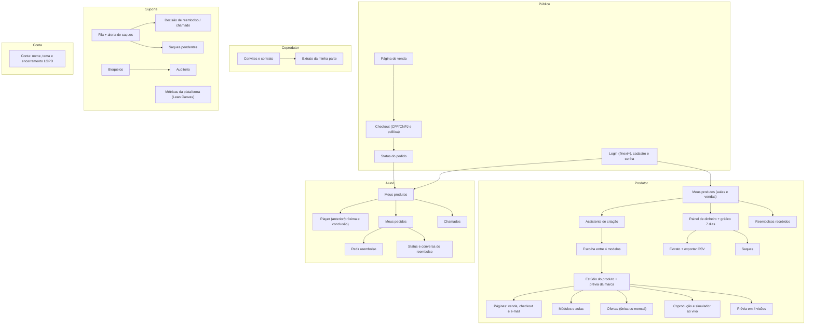

# Telas, testes e roadmap

## 1. Mapa de telas

## 2. Telas e requisitos

| Tela | Requisitos | Observação de design |
| --- | --- | --- |
| Assistente de criação | RF-10 | Uma pergunta por passo, barra de progresso, marca do produtor |
| Escolha de modelo | RF-10, RF-11 | 4 modelos (`online-course`, `mentorship`, `subscription-club`, `workshop`) com prévia na marca |
| Estúdio do produto | RF-12, RF-13, RF-15 | `Checklist` de pendências, link público em `CopyField`, prévia ao vivo de `BrandHero` e edição das 3 páginas (`sales`, `checkout`, `access_email`) |
| Prévia do produto | RF-16 | 4 visões somente leitura na marca do produtor: venda, checkout, e-mail de acesso e curso |
| Checkout e pedido | RF-20 a RF-23, D5 | Ofertas únicas e mensais, máscara progressiva de CPF/CNPJ e política de reembolso antes de pagar |
| Player do aluno | RF-24 | Contador de módulo/aula, `Aula anterior` / `Próxima aula`, progresso acessível e alerta de conclusão |
| Painel de dinheiro | RF-41, RF-42, RF-45 | Três cartões (retido, liberado, sacado), gráfico de barras de 7 dias, próximas liberações e alertas de bloqueio |
| Extrato e CSV | RF-40, RF-43, RF-53 | Filtros, contagem total/páginas, regra aplicada por linha e `GET /api/statement/export` (UTF-8 BOM sanitizado) |
| Coprodução | RF-50 a RF-53 | Convite, status do aceite e simulador reativo ao vivo (com fallback GET sem JS) |
| Status do reembolso | RF-31, RF-33 | Etapas, responsável atual, prazo, conversa e aviso por e-mail ao produtor fora da garantia |
| Fila e saques do suporte | RF-44, RF-60 | Reembolsos escalados por prazo, chamados abertos e banner de saques aguardando revisão |
| Métricas da plataforma | Lean Canvas, RF-60 | Mediana até publicar, taxa de publicação, 1ª resposta em reembolso, volume, receita de taxas, bloqueios e chamados por produtor |
| Conta e aparência | RNF-04, RNF-06 | Edição de nome, tema (`system`/`light`/`dark` em `kriup_theme`) e encerramento/anonimização LGPD em dois passos |

## 3. Plano de testes

| Nível | O que cobre | Ferramenta |
| --- | --- | --- |
| Unitário | Split e arredondamento (RN-05), simulação ao vivo, datas de liberação (RN-04), transições de estado, adaptadores Asaas/Resend, textos e filtros | Vitest, com testes de propriedade (soma das partes = líquido) |
| Integração | Transação de pagamento, assinaturas mensais, webhook repetido (RN-15), estorno com saldo insuficiente (RN-07), encerramento LGPD, métricas, contadores e links de todos os e-mails | Vitest com PostgreSQL de teste |
| Ponta a ponta | Jornadas completas entre perfis (`journey.spec.ts`), UC-01 a UC-09, navegação por perfil (`navigation.spec.ts`), conta/tema/LGPD e exportação CSV | Playwright (desktop e 375 px) |
| Acessibilidade e performance | Axe sem violação em todas as rotas nos temas claro e escuro (`review-a11y.spec.ts`); LCP público < 2,5 s e capturas finais (`pnpm test:review`) | Playwright + `@axe-core/playwright` |
| Segurança | Varredura de todas as rotas e formulários de `(app)` + `GET /api/statement/export` contra outros perfis, outros donos e anônimos (`review-access.spec.ts`) | Playwright API + banco |
| Usabilidade | Tempo e pontos de confusão para criar o primeiro produto, medido com 3 a 5 pessoas não técnicas (`produto/teste-de-uso.md`) | Teste moderado, roteiro fixo (lote 9.4) |

Critério de pronto para cada requisito M: teste automatizado do caminho feliz e de um caminho de erro.

## 4. Roadmap

Fases 0 a 6 do código concluídas; resta a execução presencial do teste de uso (lote 9.4).

| Fase | Entrega | Requisitos | Estado |
| --- | --- | --- | --- |
| 0. Base | Repositório, SvelteKit, banco, migrações, CI com testes, login e conta LGPD | RF-01, RF-04, RNF-04, RNF-06 | Concluída |
| 1. Produto | 4 modelos, assistente, estúdio das 3 páginas, aulas, ofertas únicas/mensais, prévia e publicar | RF-10 a RF-16, D5 | Concluída |
| 2. Venda | Página de venda, checkout (simulado ou Asaas), webhook, e-mail (log ou Resend), matrícula e player | RF-20 a RF-24, D2 | Concluída |
| 3. Dinheiro | Lançamentos, retenção, painel com gráfico de 7 dias, extrato com CSV, saque revisado pelo suporte | RF-40 a RF-44, F2 | Concluída |
| 4. Reembolso | Pedido, aviso ao produtor, estados, prazos, escalonamento, conversa e fila do suporte | RF-30 a RF-36, RF-60 | Concluída |
| 5. Coprodução | Convite, simulador ao vivo, contrato versionado, aceite e extrato por parte | RF-50 a RF-53 | Concluída |
| 6. Fechamento | Bloqueios com motivo, auditoria, métricas Lean Canvas, revisão axe/acesso/LCP e teste de uso | RF-45, RF-61, RF-62 | Código pronto; falta lote 9.4 |

## 5. Decisões

| # | Decisão | Estado |
| --- | --- | --- |
| D1 | Prazo da apresentação e número de pessoas no grupo | Em aberto (grupo) |
| D2 | Stack de `arquitetura.md` (SvelteKit, Postgres, Drizzle, Asaas e Resend) | **Decidida:** implementada com adaptadores ligados por variáveis opcionais de ambiente |
| D3 | Parâmetros de taxa, garantia, prazos e saque (RN-02, RN-03, RN-08, RN-13) | Em aberto para calibragem final após teste de uso (valores atuais centralizados em `domain/params.ts`) |
| D4 | Receita da plataforma no Lean Canvas | Em aberto no documento de negócio (no produto, calculada pelas taxas de venda e saque e exibida em `/support/metrics`) |
| D5 | Assinatura entra no MVP ou só pagamento único? (RN-16) | **Decidida:** ofertas de pagamento único (`one_time`) e assinatura mensal (`monthly`, modelo `subscription-club`) suportadas ponta a ponta |
| D6 | Reserva de 10% e 20% por 35 dias atribuída à Cakto: confirmar na plataforma antes de citar | Em aberto (grupo) |
