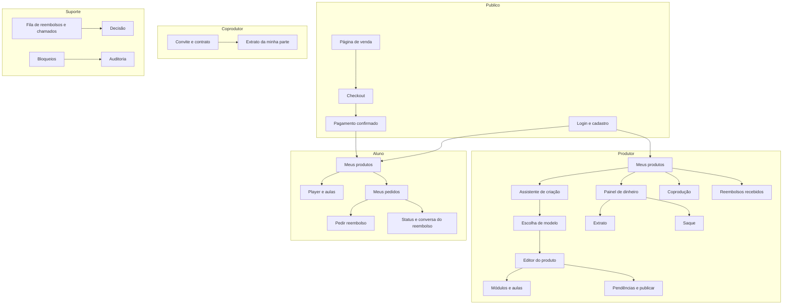

# Telas, testes e roadmap

## 1. Mapa de telas

## 2. Telas e requisitos

| Tela | Requisitos | Observação de design |
| --- | --- | --- |
| Assistente de criação | RF-10 | Uma pergunta por passo, barra de progresso, exemplo ao lado |
| Escolha de modelo | RF-10, RF-11 | Pré-visualização já com a marca do produtor |
| Editor do produto | RF-12, RF-13 | Seções empilhadas, edição no próprio lugar |
| Pendências e publicar | RF-15 | Lista com link direto para cada pendência |
| Painel de dinheiro | RF-41, RF-42, RF-45 | Três cartões (retido, liberado, sacado) e linha do tempo da próxima liberação |
| Extrato | RF-40, RF-43 | Cada linha explica a regra aplicada |
| Coprodução | RF-50 a RF-53 | Mostra percentual, status do aceite e simulação de uma venda |
| Status do reembolso | RF-31 | Etapas, responsável atual, prazo e conversa |
| Fila do suporte | RF-60 | Ordenada pelo prazo mais próximo |

## 3. Plano de testes

| Nível | O que cobre | Ferramenta |
| --- | --- | --- |
| Unitário | Split e arredondamento (RN-05), datas de liberação (RN-04), transições de reembolso, limites de coprodução | Vitest, com teste de propriedade: soma das partes = líquido |
| Integração | Transação de pagamento (pedido, matrícula, lançamentos), webhook repetido (RN-15), estorno com saldo insuficiente (RN-07) | Vitest com banco de teste |
| Ponta a ponta | UC-01 criar e publicar; UC-02 comprar e acessar; UC-04 pedir reembolso até concluir; UC-08 coprodução | Playwright |
| Segurança | Aluno não acessa dados de outro; produtor não vê produto de outro; rotas do suporte fechadas | Playwright e testes de rota |
| Usabilidade | Tempo e pontos de confusão para criar o primeiro produto, medido com 3 a 5 pessoas não técnicas | Teste moderado, roteiro fixo |

Critério de pronto para cada requisito M: teste automatizado do caminho feliz e de um caminho de erro.

## 4. Roadmap sugerido

Ordem pensada para ter uma venda ponta a ponta o mais cedo possível. Prazos em semanas dependem da data da apresentação, que ainda está em aberto.

| Fase | Entrega | Requisitos |
| --- | --- | --- |
| 0. Base | Repositório, SvelteKit, banco, migrações, CI com testes, login | RF-01, RF-04, RNF-04 |
| 1. Produto | Modelos, assistente, rascunho gerado, aulas, publicar | RF-10 a RF-15 |
| 2. Venda | Página de venda, checkout simulado, webhook, matrícula, área de membros | RF-20 a RF-24 |
| 3. Dinheiro | Lançamentos, retenção, painel, saque simulado | RF-40 a RF-44 |
| 4. Reembolso | Pedido, estados, prazos, escalonamento, fila do suporte | RF-30 a RF-36, RF-60 |
| 5. Coprodução | Convite, contrato, aceite, extrato por parte | RF-50 a RF-53 |
| 6. Fechamento | Bloqueios com motivo, auditoria, teste de uso, ajustes e apresentação | RF-45, RF-61, RF-62 |

## 5. Decisões em aberto

| # | Decisão | Quem decide |
| --- | --- | --- |
| D1 | Prazo da apresentação e número de pessoas no grupo | Grupo |
| D2 | Stack proposta em `arquitetura.md` (Postgres, Drizzle, Resend) | Grupo |
| D3 | Parâmetros de taxa, garantia, prazos e saque (RN-02, RN-03, RN-08, RN-13) | Grupo, após o teste de uso nas três plataformas |
| D4 | Receita da plataforma (hoje "a definir" no Lean Canvas) | Grupo |
| D5 | Assinatura entra no MVP ou só pagamento único? (RN-16) | Grupo |
| D6 | Reserva de 10% e 20% por 35 dias atribuída à Cakto: confirmar na plataforma antes de citar | Grupo |
